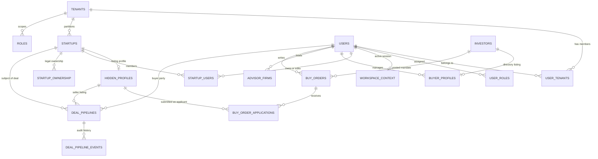

# PitchSnack: Complete System Architecture & Operational Guide
**Version:** Current Production Architecture (as of November 2026)  
**Classification:** Documentation Only  

---

## 1. System Overview

### 1.1 What PitchSnack Does
PitchSnack is a bilingual (English / Thai) M&A and investment marketplace platform tailored for Thailand and Southeast Asia. It connects three primary market participants:
1. **Sellers (Business Owners):** Founders and business owners who register their private SME or startup, verify their corporate identity against official government records (Department of Business Development - DBD), generate valuation and financial reports, and list their business for acquisition or investment.
2. **Buyers (Investors / Private Equity / Corporates):** Individual angels, family offices, private equity firms, and corporate M&A teams who browse curated listings, post acquisition mandates on the **Businesses Wanted** board, sign digital Non-Disclosure Agreements (NDAs), and negotiate transactions.
3. **Advisors (M&A Brokers / Financial Advisors / Legal Counsel):** Accredited transaction advisors and advisory firms who represent buy-side or sell-side clients and manage mandate pipelines.

All interactions are overseen by **PitchSnack Control (Platform Administrators)**, who review and verify listings, approve buy-order advertisements, manage official company data extractions, and represent client businesses managed directly by PitchSnack.

---

### 1.2 Main Parts of the Application

| Module / Area | Route / Surface | Purpose & Functionality |
| :--- | :--- | :--- |
| **Marketplace Discovery** | `/marketplace/*` | Public/semi-private exploration engine. Includes: <br>• **Browse Businesses:** Anonymized listings showing sector, deal type, and financial ranges.<br>• **Browse Investors:** Public investor mandates and criteria.<br>• **Browse Advisors:** Directory of verified advisory firms.<br>• **Businesses Wanted:** Buyer-posted acquisition requirements ("buy orders"). |
| **Seller Workspace ("My Company")** | `/my-startups`, `/company/$id/setup` | Seller onboarding and management portal. Enables founders to fill business particulars, upload logos/covers, complete the 6-step setup wizard, generate DBD reports, and submit listings for admin approval. |
| **Buyer Workspace ("My Company")** | `/buyer/my-company`, `/buyer/mandate` | Investor profile management. Allows buyers to configure their investment thesis, target ticket size, sector preferences, and submit profiles for admin verification. |
| **Advisor Workspace ("My Company")** | `/advisor/my-company`, `/advisor/company/$id/setup` | Firm credentialing, team roster, fee schedule configuration, and client mandate oversight. |
| **Deal Pipeline & Agreements** | `/pipeline/*` | Unified 6-stage deal execution room (NDA Request → NDA Approved → LOI Exchange → Due Diligence → Closing). Houses encrypted transaction chat and the Bangkok-time signed LOI countdown tracker. |
| **Businesses Wanted** | `/marketplace/businesses-wanted`, `/buyer/my-advertisements` | Dedicated buy-side mandate engine where verified buyers publish acquisition briefs ("buy orders") and live, approved sellers can submit discreet applications. |
| **Due Diligence & Reports Hub** | `/my-reports`, `/admin/paid-reports` | 7-part intelligence suite (Company Overview, Registration, Income Statement, Balance Sheet, Financial Ratios, Peer Valuation, and 6-Point Verification). Powered by the "DBD Fetch-Once" database. |
| **Control Admin Portal** | `/admin/*` | Multi-section back-office for Control Operators: <br>• **Approvals:** One-step bilingual translation and verification queue for listings and investor profiles.<br>• **Advertisement:** Review and posting workflow for buy orders.<br>• **Access Codes:** Soft-launch invitation and trial plan quota engine.<br>• **Paid Reports:** Linking DBD records to un-ordered companies.<br>• **Plans & Reports Pricing:** Central price matrix and quarterly allowance scheduler.<br>• **Analytics & Messages Help Desk:** Operational oversight and customer support. |
| **Tenant Management** | `/tenants` | Multi-tenant organizational management for managing client brokerage tenants and workspaces. |

---

### 1.3 Entity Relationship Diagram (Mermaid)



---

## 2. Tenants

### 2.1 What a Tenant Is and How It Is Stored
A **Tenant** (`public.tenants` table) represents an isolated institutional organization or multi-agent brokerage workspace.
* **Storage Schema (`public.tenants`):**
  * `id` (`uuid`, Primary Key)
  * `tenant_code` (`varchar(16)`, Unique, e.g. `ACME`, `control`)
  * `tenant_name` (`text`, e.g. "Acme Ventures")
  * `status` (`text`, default `'Active'`, values: `Active`, `Draft`, `Suspended`, `Archived`, `Deleted`)
  * `created_at`, `updated_at`, `created_by`, `updated_by`

Tenants partition database entities such as `startups` and `investors` by storing a foreign key `tenant_id`. Users are affiliated with tenants through the junction table `public.user_tenants` (`user_id`, `tenant_id`, `workspace_type`, `is_default`).

---

### 2.2 Control Workspace vs Client Tenant
* **Control Workspace (`is_control = true`, tenant_code = `'control'`):**
  * **Static Tenant ID:** `9df87a29-e8ef-4dbc-9c63-28410d45b985`
  * **Nature:** The Control workspace is **not a client tenant**. It is the PitchSnack platform operator root.
  * **Behavior:** When an administrator works in Control mode (`active_tenant_id` is `null` or points to the Control UUID), backend queries in `src/lib/workspace-scope.server.ts` **disable tenant filtering**, giving administrators full cross-tenant visibility.
* **Client Tenant:**
  * Represents an external client organization (e.g. Acme Ventures).
  * Data queries are strictly scoped: users in a client tenant can only see startups, analytics, and records where `tenant_id` matches their active tenant.

---

### 2.3 Current Tenants in the Database

Audited directly against live database state:

| Tenant Name | Tenant Code | UUID | Status | Type | Users (`user_tenants`) | Companies (`startups`) | Classification |
| :--- | :--- | :--- | :--- | :--- | :--- | :--- | :--- |
| **Acme Ventures** | `ACME` | `59db2338-4631-4209-91d2-5d931e723168` | Active | Client | 25 | 53 | Seed / Test Tenant (PRD2 testing) |
| **Zeta Capital** | `ZETA` | `6d4a9a7b-69f1-4d39-afb2-654fae817a2d` | Active | Client | 2 | 2 | Demo / Test Tenant |
| **Nova Labs** | `NOVA` | `e16ee443-17b7-48c3-9d49-6a343d103080` | Active | Client | 1 | 1 | Demo / Test Tenant |
| **Control** | `control` | `9df87a29-e8ef-4dbc-9c63-28410d45b985` | Active | Control | 0* | 0* | Official Platform Operator Workspace |

*\*Note on Control:* Administrators (such as Dan Antakon) belong to the `CONTROL` platform role in `user_roles`. Furthermore, PitchSnack-managed companies (26 listings) belong to `startups` with `run_by = 'pitchsnack'` rather than having their `tenant_id` set to the Control UUID. In addition, 13 registered marketplace users exist independently of any client tenant.

---

### 2.4 How a Tenant Is Created
* **Creation Mechanism:** Via the frontend route `/_authenticated/tenants` using `TenantFormDialog`.
* **Authorization:** Database Row-Level Security (RLS) policy `prd2_tenants_insert` enforces:
  `WITH CHECK (public.is_control(auth.uid()))`.
* **Rule:** Only an authenticated user possessing the `CONTROL` platform role can create a new tenant. Client tenants cannot create sub-tenants.

---

### 2.5 How the App Determines Active Tenant & Tenant Switching
* **Storage of Active Context:** The user's current session context is recorded in the table `public.workspace_context`:
  * `user_id` (`uuid`, Primary Key)
  * `active_tenant_id` (`uuid`, Nullable)
  * `active_workspace_type` (`text`: `CONTROL`, `TENANT`, `STARTUP`, `INVESTOR`)
* **Resolution Hierarchy:**
  1. `workspace_context.active_tenant_id`
  2. If null, fallback to `users.primary_tenant_id`
  3. If null, fallback to the user's first tenant in `user_tenants`
  4. If none, the context is treated as global platform / Control.
* **Can a user switch tenants?**
  **Yes.** Implemented in `src/lib/session-context.functions.ts` via the server function `switchWorkspace`:
  * A regular user can only switch to a tenant where an entry exists in `public.user_tenants` matching their `user_id`.
  * A user with `CONTROL` role can switch to **any** tenant ID or set it to `null` (Control view).
  * Every switch event is audited in `public.security_events`.

---

## 3. Users and Roles

The PitchSnack permission architecture operates on two distinct layers:
1. **Application-level Role (`account_role`):** Governs marketplace personas and primary navigation.
2. **Platform & Tenant RBAC (`public.roles` & `public.user_roles`):** Governs fine-grained database capabilities and tenant access.

---

### 3.1 Role Categories

#### A. Account Roles (`public.users.account_role`)
Stored directly as a column on each user profile (`users.account_role`):
* `seller`: Business owner / founder seeking investment or selling their company.
* `buyer`: Investor, PE fund, or corporate acquirer.
* `advisor`: M&A broker, corporate advisor, or transaction intermediary.
* `admin`: PitchSnack platform team member.

#### B. Tenant Roles (`public.roles` scoped to a `tenant_id` in `public.user_roles`)
* `TENANT_ADMIN`: Full administrative control over a client tenant's users, startups, and settings.
* `TENANT_AGENT`: Dealmaker or associate within a client tenant.
* `STARTUP_USER`: Company representative linked to a specific tenant portfolio company.
* `INVESTOR_USER`: Institutional investor affiliated with a specific tenant.
* *Tenant AI Agents:* `TENANT_STARTUP_AI`, `TENANT_INVESTOR_AI`, `TENANT_DEAL_AI`.

#### C. Platform & Control Roles (`public.roles` with `tenant_id IS NULL` in `public.user_roles`)
* `CONTROL`: Platform super-administrator. Possesses all permissions in `ROLE_PERMISSIONS`. Evaluated true by SQL function `public.is_control(_user_id)`.
* `MASTER_AGENT`: Cross-tenant operator permitted to manage assigned tenants listed in `public.master_agent_tenants`.
* *Platform AI Agents:* `CONTROL_RESEARCH_AI`, `CONTROL_STARTUP_DISCOVERY_AI`, `CONTROL_INVESTOR_DISCOVERY_AI`, `MASTER_AGENT_AI`.

---

### 3.2 Role Combinations & Real-World Examples
Because role layers are decoupled, a user can hold an `account_role` while simultaneously possessing platform or tenant RBAC privileges:
* **Example 1: Platform Control Admin acting as Seller or Buyer**
  * `account_role` = `seller` (or toggled via persona switcher)
  * `user_roles` contains `role_code` = `CONTROL`
  * *Outcome:* The user experiences the seller or buyer interface (e.g. testing onboarding or browsing buy orders), while retaining platform privileges (e.g. applying on behalf of PitchSnack-managed companies).
* **Example 2: Client Tenant Admin who is a Seller**
  * `account_role` = `seller`
  * `user_roles` contains `TENANT_ADMIN` for tenant `Acme Ventures`
  * *Outcome:* Can manage Acme Ventures team members and portfolio companies, while having access to the marketplace seller tools.

---

### 3.3 User Onboarding & Tenant Joining
1. **Public Signup (`/signup`):**
   * Handled by Supabase Auth (`supabase.auth.signUp`).
   * Database trigger `handle_new_auth_user()` creates a row in `public.users` with status `'Pending'`.
   * Onboarding questionnaire answers are saved to `public.signup_answers`.
   * `finishSignup` sets `account_role` (`seller`, `buyer`, or `advisor`), creates initial workspace records, and applies soft-launch trial plans.
   * *Tenant affiliation:* Pure marketplace users join with `primary_tenant_id = null`.
2. **Tenant Invitation (`inviteUser` in `src/lib/users.functions.ts`):**
   * Initiated by a Control Admin or Tenant Admin.
   * Calls `adminInviteUserByEmail` via Supabase Admin Auth.
   * Upserts `public.users`, inserts a row into `public.user_tenants` with the specified `tenantId`, and inserts into `public.user_roles` with the selected `roleCode`.

---

## 4. Key Flows: Step by Step

### Flow 1: New User Signup & Soft-Launch Onboarding
* **Actor:** External visitor.
* **Step 1:** Access Gate Check. If soft-launch is active (`soft_launch_settings.gate_on = true`), the visitor must supply an active access code or signed invitation pass (`access-gate.functions.ts`).
* **Step 2:** Account Creation. User registers email and password. Supabase Auth trigger `on_auth_user_created` fires `handle_new_auth_user()`, creating a `public.users` record.
* **Step 3:** Persona Selection. The user chooses Seller, Buyer, or Advisor. Answers are stored in `public.signup_answers`.
* **Step 4:** Completion (`finishSignup`). The user's `account_role` is saved. The system provisions:
  * For Seller: Creates a `startups` draft and links the user in `startup_users`.
  * For Buyer: Creates `buyer_profiles` and an `investors` draft.
  * For Advisor: Creates an `advisor_firms` draft.
  * If an access code was used: A complimentary subscription is created in `public.subscriptions` from `public.plans`.

---

### Flow 2: Adding a Company & Seller Setup Wizard
* **Actor:** Seller or Admin.
* **Step 1:** Creation. `createStartup` (`src/lib/startups.functions.ts`) inserts a row into `public.startups`:
  * Columns set: `startup_name`, `created_by`, `run_by = 'owner'`, `visibility = 'Tenant'`.
  * Automatically creates ownership links: `startup_users` (`role = 'owner'`) and `startup_ownership`.
* **Step 2:** 6-Step Setup Wizard (`/company/$id/setup`). Seller enters:
  1. Company Basics & Registered Name
  2. Sector, Business Model, and Location
  3. Financial Highlights (Revenue, Profitability)
  4. Registered Capital & Legal Credentials
  5. Executive Bios & Founder Stories (`startup_founders.bio_story`)
  6. Confidentiality Parameters & Code Name

---

### Flow 3: Creating a Listing, Approval, and Going Live
* **Actors:** Seller and Control Admin.
* **Step 1: Listing Creation.** A corresponding confidential profile row is created in `public.hidden_profiles` with `approval_status = 'draft'`.
* **Step 2: Submission.** The seller clicks "Submit for Review". `submitListing` (`src/lib/approvals.functions.ts`) updates `approval_status = 'in_review'`.
* **Step 3: Admin Review & Bilingual Translation.**
  * Control Admin opens `/admin` (Approvals tab).
  * The admin verifies the registered corporate ID against DBD records.
  * Under the **Translation** tab, English and Thai twins are validated (`saveOneStepReview`). Draft edits are staged in `admin_review_draft` without affecting live data.
* **Step 4: Verify & Publish.**
  * Admin clicks "Verify and publish" (`verifyAndPublish`).
  * Server function validates that English and Thai texts are present and DBD checks match.
  * `hidden_profiles` is updated: `approval_status = 'live'`, `status = 'live'`, `live_snapshot` populated.
  * Action is permanently logged to `public.approval_events` (`action = 'publish'`).
  * The listing is immediately published to `/marketplace/browse`.

---

### Flow 4: Creating a Buy Order in Businesses Wanted
* **Actors:** Verified Buyer (or Control Admin on behalf of Buyer).
* **Step 1: Drafting.** Buyer navigates to `/buyer/my-advertisements` and clicks "Post Advertisement".
  * Submits form (`saveBuyOrderDraft` in `src/lib/buy-orders.functions.ts`).
  * Inserts into `public.buy_orders`: `kind = 'sealed'`, `status = 'draft'`, target revenue, price range, property requirements, and bilingual texts (`name_on_card_th`, `description_th`).
* **Step 2: Submission to Admin.** Buyer clicks "Submit to Admin" (`sendBuyOrderToAdmin`).
  * Status updates: `status = 'pending_review'`, `sent_to_admin_at = now()`.
* **Step 3: Admin Approval & Posting.**
  * Control Admin opens `/admin/advertisement`.
  * Admin reviews requirements, sets cover image (upload, sector pick, or fallback), and clicks "Post Advertisement" (`postBuyOrder`).
  * Status updates: `status = 'posted'`, `posted_at = now()`, `closes_on = now() + periodMonths`.
  * The buy order appears live on `/marketplace/businesses-wanted`.

---

### Flow 5: Applying to a Buy Order (Seller vs Control Admin)
* **Actors:** Live Approved Seller OR Control Admin.
* **A. Real Seller Flow:**
  * Seller visits `/marketplace/businesses-wanted` in Seller view.
  * The system calls `mySellerListing(userId)`.
  * **Gate:** If the seller's listing is not live (`approval_status != 'live'`), the Apply button is disabled or locked with an informative tooltip.
  * When live, clicking **Apply** executes `applyToBuyOrder`.
  * A record is inserted into `public.buy_order_applications` (`status = 'applied'`, `business_id = hidden_profile.id`).
* **B. Control Admin Flow (PitchSnack-Managed Companies):**
  * Control Admin visits in Seller view.
  * The system calls `myApplyContext` -> `managedSellers(liveOnly = true)`.
  * Scans all startups where `tenant_id` is Control or `run_by = 'pitchsnack'` and all owners are admin accounts.
  * If managed companies exist, the admin sees an amber **Apply** button which opens a picker showing eligible managed companies.
  * If no managed companies are configured, the button is hidden.

---

### Flow 6: How PitchSnack Manages Companies on a Client's Behalf (`managedSellers`)
* **Definition:** A company actively managed by PitchSnack staff rather than directly operated by the business owner.
* **Identification Logic (`src/lib/managed.server.ts`):**
  * A startup is recognized as "Managed by PitchSnack" if:
    1. Its `run_by` column in `public.startups` is set to `'pitchsnack'`; OR
    2. It exists in the Control workspace AND its creator and all assigned members in `startup_users` / `startup_ownership` are Admin users.
* **Handover Process (`src/lib/profile-handover.functions.ts`):**
  * When a managed company is transferred to a real business owner:
    1. PitchSnack Admin executes `handoverProfile`.
    2. The real owner's email is bound.
    3. `startups.run_by` transitions from `'pitchsnack'` to `'owner'`.
    4. New owner is added to `startup_users`.
    5. Event is logged to `profile_handover_events`.

---

### Flow 7: Deal Pipeline & NDA Execution
* **Actors:** Buyer and Seller.
* **Step 1: NDA Request.** Buyer clicks "Request NDA" on a listing in Browse.
  * Server function `requestListingNda` creates a row in `public.deal_pipelines` at Step 1 (`step = 'nda'`, `status = 'pending'`).
  * Deal pipeline event logged in `public.deal_pipeline_events`.
* **Step 2: Seller Decision.** Seller reviews request in `/pipeline/nda-invitations`.
  * Seller clicks "Accept & Sign NDA".
  * Server updates `deal_pipelines`: `status = 'approved'`, `nda_signed_at = now()`.
* **Step 3: Gated Data Unlocked.**
  * Prior to NDA approval, the buyer only sees anonymized ranges.
  * Once approved, `getProfileBox` and `invitationPrivateProfile` grant access to the full legal name, exact DBD financials, address, and founders.

---

### Flow 8: Due Diligence Reports & DBD "Fetch-Once" Store
* **Actors:** Control Admin and Authorized Users.
* **Architecture:** Government filings from the Department of Business Development (DBD) are stored in `public.dbd_company_records` keyed by registration number (`registered_number`).
* **Fetch-Once Guarantee:** Data is fetched from DBD once upon first admin verification. Subsequent report orders or viewings read directly from `dbd_company_records` without re-scraping.
* **Analyst Overrides:** Admins can adjust statement items via `public.analyst_statement_edits`. These edits persist and re-apply on top of stored DBD data even if a refresh is executed.

---

## 5. Control and Permissions

### 5.1 Comprehensive Permissions Matrix

| App Action / Capability | Control Admin | Master Agent | Client Tenant Admin | Client Tenant Agent (`TENANT_AGENT`) | Portfolio Seller (`STARTUP_USER`) | Tenant Investor (`INVESTOR_USER`) | Marketplace Seller (`seller`) | Marketplace Buyer (`buyer`) | Advisory Firm (`advisor`) | Enforcing Mechanism |
| :--- | :---: | :---: | :---: | :---: | :---: | :---: | :---: | :---: | :---: | :--- |
| **Create New Tenant** | **Allowed** | Forbidden | Forbidden | Forbidden | Forbidden | Forbidden | Forbidden | Forbidden | Forbidden | RLS `prd2_tenants_insert` (`is_control`) |
| **Switch Workspace** | **Any** | Assigned | Own Only | Own Only | Own Only | Own Only | Forbidden | Forbidden | Forbidden | `switchWorkspace` in `session-context.functions.ts` |
| **Invite User to Tenant** | **Allowed** | Assigned | Own Tenant | Forbidden | Forbidden | Forbidden | Forbidden | Forbidden | Forbidden | `requireControlOrTenantAdmin` in `users.functions.ts` |
| **Suspend User Account** | **Allowed** | Forbidden | Own Tenant | Forbidden | Forbidden | Forbidden | Forbidden | Forbidden | Forbidden | `suspendUser` in `users.functions.ts` |
| **Create Company Profile** | **Allowed** | Allowed | Own Tenant | Own Tenant | Forbidden | Forbidden | **Own Only** | Forbidden | Forbidden | `createStartup` + `can_access_startup` policy |
| **Edit Company Profile** | **Any** | Assigned | Own Tenant | Own Tenant | **Assigned** | Forbidden | **Own Only** | Forbidden | Forbidden | RLS on `startups` (`can_access_startup`) |
| **View Own Tenant Private Data** | **Any** | Assigned | **Own Tenant** | **Own Tenant** | **Assigned** | Forbidden | **Own Only** | Forbidden | Forbidden | RLS on `startups` & `hidden_profiles` |
| **View Market Pre-NDA Facts** | **Allowed** | Forbidden | Forbidden | Forbidden | Forbidden | Forbidden | **Own Only** | Forbidden | Forbidden | `getProfileBox` / RLS projection |
| **View Market Post-NDA Facts** | **Allowed** | Forbidden | Forbidden | Forbidden | Forbidden | Forbidden | **Own Only** | **Approved** | **Invited** | `deal_pipelines` approved NDA join check |
| **Submit Listing for Review** | **Allowed** | Allowed | Own Tenant | Own Tenant | **Assigned** | Forbidden | **Own Only** | Forbidden | Forbidden | `submitListing` server validation |
| **Approve & Publish Listing** | **Allowed** | Forbidden | Forbidden | Forbidden | Forbidden | Forbidden | Forbidden | Forbidden | Forbidden | DB trigger `tg_guard_listing_approval` + `is_control` |
| **Unpublish / Withdraw Listing**| **Allowed** | Forbidden | Forbidden | Forbidden | **Assigned** | Forbidden | **Own Only** | Forbidden | Forbidden | `unpublishListing` / `withdrawListing` |
| **Resume Approved Listing** | **Allowed** | Forbidden | Forbidden | Forbidden | **Assigned** | Forbidden | **Own Only** | Forbidden | Forbidden | `resumeListing` in `approvals.functions.ts` |
| **Create Buy Order (Draft)** | **Allowed** | Forbidden | Forbidden | Forbidden | Forbidden | Forbidden | Forbidden | **Allowed** | Forbidden | `saveBuyOrderDraft` (buyer or admin role) |
| **Approve & Post Buy Order** | **Allowed** | Forbidden | Forbidden | Forbidden | Forbidden | Forbidden | Forbidden | Forbidden | Forbidden | `postBuyOrder` (`requireControlAdmin`) |
| **Apply to Buy Order (Own)** | Forbidden* | Forbidden | Forbidden | Forbidden | **Assigned** | Forbidden | **Allowed** | Forbidden | Forbidden | `applyToBuyOrder` (live listing check) |
| **Apply (Managed Company)** | **Allowed** | Forbidden | Forbidden | Forbidden | Forbidden | Forbidden | Forbidden | Forbidden | Forbidden | `myApplyContext` (`managedSellers` check) |
| **Request NDA on Listing** | Forbidden* | Forbidden | Forbidden | Forbidden | Forbidden | Forbidden | Forbidden | **Allowed** | Forbidden | `requestListingNda` (buyer quota check) |
| **Approve NDA Request** | **Allowed** | Forbidden | Forbidden | Forbidden | **Assigned** | Forbidden | **Own Only** | Forbidden | Forbidden | `decideDealStep` (company owner check) |
| **Join Deal as Advisor** | Forbidden | Forbidden | Forbidden | Forbidden | Forbidden | Forbidden | Forbidden | Forbidden | **Invited** | `joinAdvisorDeal` in `advisor-pipeline.functions.ts` |
| **Extract / Refresh DBD Store**| **Allowed** | Forbidden | Forbidden | Forbidden | Forbidden | Forbidden | Forbidden | Forbidden | Forbidden | `dbd-store.functions.ts` (`is_control`) |
| **Manage Subscription Plans** | **Allowed** | Forbidden | Forbidden | Forbidden | Forbidden | Forbidden | Forbidden | Forbidden | Forbidden | `admin-plans.functions.ts` (`is_control`) |
| **Manage Report Prices** | **Allowed** | Forbidden | Forbidden | Forbidden | Forbidden | Forbidden | Forbidden | Forbidden | Forbidden | `report-pricing.functions.ts` (`is_control`) |

### 5.2 What the Control Workspace Can See and Do
* Full cross-tenant access to all companies (`public.startups`), listings (`public.hidden_profiles`), and transactions.
* Exclusive authority to approve, publish, reject, and unpublish marketplace listings.
* Exclusive authority to verify and post Businesses Wanted buy orders.
* Exclusive access to the DBD Fetch-Once data store (extraction, manual entry, refresh, and deletion).
* Authority to manage platform subscription plans, report price cards, and soft-launch access codes.
* Capability to act as a seller on behalf of PitchSnack-managed companies.

---

### 5.3 What a Client Tenant Can See and Do
* **Visible:**
  * Startups, investors, and deals where `tenant_id` equals the client tenant's ID.
  * Marketplace browse cards (anonymized publicly visible listings).
  * Their own team members in `user_tenants`.
* **Hidden / Forbidden:**
  * Cannot see other client tenants' private startups or users.
  * Cannot access Control Admin routes (`/admin/*`).
  * Cannot approve or publish listings to the public marketplace.
  * Cannot post or approve Businesses Wanted buy orders.
  * Cannot view unverified DBD data or execute raw extractions.

---

### 5.4 Frontend-Only vs Server-Enforced Checks

PitchSnack strictly follows a **zero-trust server security architecture**:
1. **Server Enforced (Authoritative):**
   * **Database Triggers:** For example, `tg_guard_listing_approval` prohibits any database update that sets a listing to `approval_status = 'live'` unless the executing database transaction satisfies `is_control(auth.uid())`.
   * **Server Functions (`createServerFn`):** Every mutation validates user authentication (`requireSupabaseAuth`) and enforces explicit role checks (`requireControlAdmin`, `requireRole`, `is_control`).
   * **Row Level Security (RLS):** Policies on `startups`, `deals`, `user_roles`, and `tenants` prevent direct cross-tenant reads or unauthorized updates via client Supabase queries.
2. **Frontend Presentation (Non-authoritative UX aids):**
   * Hiding the "Apply" button when a user is not in Seller persona or has no live listing.
   * Disabling the "Verify and publish" button until all bilingual fields are filled.
   * Showing locked tooltips on unavailable features.
   * Even if a malicious user bypasses the UI and invokes the underlying server functions directly, the server functions and database triggers reject the request.

---

## 6. Key Files, Components & Migrations

### 6.1 Server Functions (`src/lib/*.functions.ts`, `*.server.ts`)
* `src/lib/workspace-scope.server.ts`: Scopes startup and list queries to the active tenant; disables filtering for Control.
* `src/lib/session-context.functions.ts`: Resolves user roles, active tenant, plan information, and executes workspace switching.
* `src/lib/managed.server.ts`: Authoritative projection that calculates PitchSnack-managed companies (`managedSellers`).
* `src/lib/buy-orders.functions.ts`: Complete lifecycle for Businesses Wanted (drafting, admin posting, applications).
* `src/lib/approvals.functions.ts`: Listing submissions, approvals, unpublishing, and admin review queries.
* `src/lib/approvals-one-step.functions.ts`: Bilingual translation twin validation and one-step approval execution.
* `src/lib/dbd-store.functions.ts`: Server operations for the DBD Fetch-Once repository (extract, refresh, manual save, delete).
* `src/lib/access-gate.functions.ts`: Cryptographic HMAC validation of soft-launch passes and device tracking.
* `src/lib/plan-access.server.ts`: Subscription enforcement, quota calculations, and role-based route gates.
* `src/lib/pipeline.functions.ts`: Deal pipeline state transitions, NDA signing, and audit trail logging.
* `src/lib/reports-hub.server.ts`: Authorization engine for the 7 due diligence and valuation reports.

### 6.2 Key Frontend Routes & Components
* `src/routes/_authenticated.tsx`: Root authenticated layout rendering navigation sidebar, approval banners, and free plan countdown bars.
* `src/routes/_authenticated/tenants.tsx`: Tenant management portal for Control administrators.
* `src/routes/_authenticated/admin/`: Control back-office routes (Approvals, Advertisement, Access Codes, Paid Reports, Plans).
* `src/components/businesses-wanted/`: Components for Businesses Wanted cards (`bw-card.tsx`), forms (`bw-form.tsx`), and details.
* `src/components/marketplace/standard-listing-card.tsx`: Standard browse card for confidential marketplace business listings.
* `src/components/my-business/approval-bits.tsx`: Seller listing lifecycle controls (Submit, Unpublish, Resume, Approval status banner).

### 6.3 Database Migrations & Schemas
* `20260601041010_0a6e8366-61b0-479f-b309-b287851545b1.sql`: Core RBAC migration defining `public.roles`, `public.user_roles`, `public.tenants`, `public.user_tenants`, and `is_control` SQL functions.
* `20260601051425_8049725f-c6c4-49ee-8789-1269434df43a.sql`: Primary Row-Level Security policies enforcing tenant isolation and Control super-access.
* `20260718134619_40a36ad1-2364-4f6e-8fe0-075bbd8b11da.sql`: Approval safeguards and triggers (`tg_guard_listing_approval`) blocking non-admin publishing.
* `20261026_bilingual_profile_texts.sql` / `0121_bilingual_profile_texts.sql`: Full bilingual EN/TH schema extensions for listings and buy orders.
* `20261028_dbd_canonical_store.sql`: Shared DBD Fetch-Once repository (`dbd_company_records`, `dbd_fetch_logs`, `analyst_statement_edits`).


---

## 7. Clarifications & Deep Dives

### 7.1 Where Do PitchSnack-Managed Companies Sit? (Tenant IDs & Rules)
* **The Reality in the Database Today:**
  All 26 companies currently flagged with `run_by = 'pitchsnack'` belong to **client seed tenants**, NOT the Control workspace:
  * **24 companies** have `tenant_id = 59db2338-4631-4209-91d2-5d931e723168` (Acme Ventures)
  * **1 company** has `tenant_id = 6d4a9a7b-69f1-4d39-afb2-654fae817a2d` (Zeta Capital)
  * **1 company** has `tenant_id = e16ee443-17b7-48c3-9d49-6a343d103080` (Nova Labs)
  * **0 companies** have `tenant_id = 9df87a29-e8ef-4dbc-9c63-28410d45b985` (Control Workspace UUID)
* **The Exact Rule in `src/lib/managed.server.ts`:**
  ```typescript
  export async function managedStartupIds(sb: Sb, startupIds: string[]): Promise<Set<string>> {
    // 1. Fetches creators of startups
    const { data: sts } = await sb.from("startups").select("id, created_by").in("id", ids);
    // 2. Fetches members in startup_users and owners in startup_ownership
    const [{ data: su }, { data: own }] = await Promise.all([
      sb.from("startup_users").select("startup_id, user_id").in("startup_id", inCtl),
      sb.from("startup_ownership").select("startup_id, owning_agent_user_id").in("startup_id", inCtl),
    ]);
    // 3. Resolves which of these users have account_role === "admin"
    const admins = await adminUserIds(sb, [...people.values()].flat());
    // 4. A startup is managed ONLY IF every owner/member is an Admin user:
    for (const s of sts) {
      const members = [...su, ...own].filter((m) => m.startup_id === s.id).map((m) => m.user_id);
      const all = [...(s.created_by ? [s.created_by] : []), ...members];
      if (all.length && all.every((u) => admins.has(u)) && members.every((u) => admins.has(u))) {
        out.add(s.id);
      }
    }
    return out;
  }
  ```
* **Why `managedSellers` in Businesses Wanted Returned 0 Companies:**
  In `src/lib/buy-orders.functions.ts`, the `managedSellers` function combines `managedStartupIds` with a tenant check:
  ```typescript
  const ctl = await controlTenantId(sb); // returns 9df87a29-e8ef-4dbc-9c63-28410d45b985
  const { data: sts } = await sb.from("startups").select("...").eq("tenant_id", ctl);
  const managed = await managedStartupIds(sb, sts.map((s) => s.id));
  ```
  Because `managedSellers` explicitly filters `startups.tenant_id = ctl`, and the 26 seed companies currently have `tenant_id` set to Acme/Zeta/Nova rather than Control, `sts` returns 0 rows. Across the entire database, 21 startups pass `managedStartupIds`, but 0 sit directly in the Control tenant.

---

### 7.2 Is `run_by = 'pitchsnack'` Enough on Its Own, or Must All Owners Be Admins?
* **They are two distinct rules used in different subsystems:**
  1. **In Handover & Profile Publishing (`src/lib/profile-handover.functions.ts`):**
     * `run_by` is an enum column (`'none' | 'owner' | 'pitchsnack'`) on `startups`, `investors`, and `advisor_firms`.
     * Here, `run_by = 'pitchsnack'` **is enough on its own** to classify a company or firm as created by PitchSnack for subsequent handover. Handover checks: `if (t?.run_by !== "pitchsnack") throw new Error("Only a managed profile is published from here.");`
  2. **In Businesses Wanted & Workspace Management (`src/lib/managed.server.ts`):**
     * `managedStartupIds` does **not** inspect the `run_by` column at all.
     * Instead, it strictly enforces **exclusive Admin ownership**: every creator in `startups.created_by`, every member in `startup_users`, and every owner in `startup_ownership` must have `account_role = 'admin'`. If even one non-admin user is added to the company, it immediately ceases to be managed by PitchSnack.

---

### 7.3 "Admin User": `account_role = 'admin'` vs the `CONTROL` Role
* **Does "admin user" mean `account_role = 'admin'` or the `CONTROL` role?**
  * In `src/lib/managed.server.ts` (`adminUserIds`), the code explicitly checks:
    `u.account_role === "admin"`.
  * It does **not** check the `CONTROL` role in `user_roles`.
* **Can a user have one without the other?**
  * **Yes, absolutely.** Audited from live database records:
    * `admin.acme@prd2.test` has `account_role = 'admin'`, but its role in `user_roles` is `TENANT_ADMIN` (it does **not** have the `CONTROL` role).
    * Platform administrators (such as `danando.ki@gmail.com` and `dan@xynal.com`) have both `account_role = 'admin'` and `CONTROL` in `user_roles`.
  * *Distinction:* `account_role = 'admin'` indicates an administrative persona and navigation privileges, while the `CONTROL` role grants platform-wide database bypass via the `public.is_control()` SQL security function.

---

### 7.4 Can a Tenant Admin View Their Tenant's Companies' Private Facts?
* **Yes, within their own tenant.**
  * In the permissions table, "View Market Pre-NDA Facts" refers to browsing **other external listings on the public marketplace**. No user (except Control Admin) can see unapproved confidential facts of outside companies before signing an NDA.
  * **Within their own tenant workspace:** A Tenant Admin has complete visibility over all startups in their tenant.
  * **Enforcing SQL Check (RLS Policy `prd2_startups_select`):**
    ```sql
    CREATE POLICY prd2_startups_select ON public.startups
      FOR SELECT TO authenticated
      USING (
        public.is_control(auth.uid())
        OR (tenant_id IS NOT NULL AND public.is_tenant_admin_of(auth.uid(), tenant_id))
        OR public.can_access_startup(auth.uid(), id)
      );
    ```
    `is_tenant_admin_of(auth.uid(), tenant_id)` returns true, allowing Tenant Admins to view all raw corporate fields (registered name, revenue, address, founders) of their tenant's portfolio companies.
  * **In the Deal Pipeline (`getProfileBox` in `src/lib/profile-box.functions.ts`):**
    `getProfileBox` is deal-specific. It checks if the caller is directly assigned to the deal in `startup_ownership` or `startup_users`. If a Tenant Admin is not personally listed as a deal member, `getProfileBox` will throw `"Not your deal"`, even though they can view the underlying startup in `/my-startups`.

---

### 7.5 Meaning of "Client Tenant Member" & Specific Roles
"Client Tenant Member" in the original table represented non-admin tenant accounts. They break down into three concrete roles:
1. **`TENANT_AGENT` (Tenant Broker / Dealmaker):**
   * Member of a client brokerage firm.
   * Can create, read, and edit all startups, investors, and deals belonging to their tenant.
   * Cannot invite users, suspend accounts, or manage roles within the tenant.
2. **`STARTUP_USER` (Portfolio Company Representative):**
   * A founder or executive affiliated with a specific tenant portfolio company.
   * Scoped strictly by `public.can_access_startup(auth.uid(), startup_id)`.
   * Can only view and edit the specific startup(s) to which they are assigned in `public.startup_users` or `public.startup_ownership`. Cannot see other startups in the same tenant.
3. **`INVESTOR_USER` (Tenant Investor):**
   * Read-only investor account tied to a tenant.
   * Granted `investors.read` permission within that tenant.
4. **`Advisor` (`account_role = 'advisor'`):**
   * External transaction advisory firm. Has access to `/advisor/my-company` and firm profile setup.
   * Does not hold tenant roles (`TENANT_ADMIN`, etc.). Operates on the marketplace level.

---

### 7.6 Master Agent: Current Users, Tenant Assignments, and Capabilities
* **Does any user have this role today?**
  * **Yes, exactly one user:**
    * **Email:** `master.agent@prd2.test`
    * **User ID:** `b3640144-10d2-410e-be72-1ec9c57cd543`
* **Which tenants are they assigned to?**
  * Mapped in the `public.master_agent_tenants` database table to **two tenants**:
    1. **Acme Ventures** (`tenant_id = 59db2338-4631-4209-91d2-5d931e723168`)
    2. **Zeta Capital** (`tenant_id = 6d4a9a7b-69f1-4d39-afb2-654fae817a2d`)
* **What exactly can they do in those tenants?**
  * In `src/lib/permissions.ts`, `MASTER_AGENT` is assigned the full `TENANT_ADMIN` permission suite:
    * `startups.read`, `startups.write`
    * `investors.read`, `investors.write`
    * `deals.read`, `deals.write`, `deals.share.*`
    * `global_startups.read`, `global_startups.import`
    * `workspace.switch` (can switch active workspace between Acme Ventures and Zeta Capital)
  * In SQL RLS (`public.user_in_tenant`), `public.is_master_agent_of(_user_id, _tenant)` evaluates true for their assigned tenants, granting full cross-tenant deal and company management across Acme and Zeta.
  * *Restrictions:* They **cannot** access Nova Labs, cannot access Control Admin routes (`/admin/*`), and cannot create new tenants.

---

### 7.7 Advisor: How "Client Mandate Oversight" Works Today
* **Can an advisor manage companies or buyers on a client's behalf today?**
  * **No.** In the current production codebase, an advisor cannot create seller listings on behalf of a client, cannot post buy orders on behalf of a client, and cannot sign primary NDAs or execute legal milestones on a client's behalf.
* **How "Client Mandate Oversight" actually operates today (`src/lib/advisor-pipeline.functions.ts`):**
  1. **Invitation by Client:** A seller or buyer participating in a deal invites an accredited advisor firm via `/pipeline` (`advisor_invitations` table).
  2. **Advisor NDA Signing:** The advisor receives the invitation in `/advisor/pipeline` and signs a tripartite digital NDA (`joinAdvisorDeal`), creating an entry in `public.deal_advisors`.
  3. **Read-Only Deal Tracking:** The advisor can monitor deal progression:
     * Key milestone dates (NDA approved date, report shared date, LOI accepted date, exclusivity expiry, SPA draft date, payment completion).
     * Deal counterparty profile summary (`advisorOtherProfile`) shared under the advisor NDA.
     * Deal history audit log (`advisorDealHistory`).
  * In summary, the Advisor role functions as an **accredited deal intermediary and transaction observer**, rather than an account proxy with delegation authority.

---

## 9. Account Manager Scenario — Questions & Answers

All answers below were checked against the codebase and the live database on 1 Nov 2026. Documentation only.

### 9.1 Default tenant for independent sellers and buyers

**Sellers** (`src/lib/seller-setup.server.ts`): `ensureSellerDraftFromSignup` uses the tenant where the user already holds `STARTUP_USER`; otherwise it reads `default_intake_settings` (one row). That row points to:

| Field | Value |
|---|---|
| Tenant | **Acme Ventures** (`ACME`) |
| Tenant ID | `59db2338-4631-4209-91d2-5d931e723168` |
| Default owning agent for new startups | `admin.acme@prd2.test` (`1577561e-…`) |

The seller is added to `user_tenants` and gets `STARTUP_USER` in Acme; the startup gets `startup_ownership` (owning agent = intake agent), `startup_ai_ownership` and a `startup_users` row (role `Founder`) for the seller.

**Buyers** (`ensureLinked` in `src/lib/buyer-investor.functions.ts`, called from `finishSignup`): the buyer's investor row is created in the **Control** tenant (`tenant_code = 'control'`, ID `9df87a29-e8ef-4dbc-9c63-28410d45b985`). Buyers are **not** added to `user_tenants` or `user_roles`, and **no `investor_ownership` row is created** for them.

**Contents of Acme Ventures today**

- Users linked to the tenant: **25**. 7 are system/test accounts (`*@prd2.test` ×5, AI agents `@snackportal.ai` ×2). The other 18 are Gmail sign-ups; many are internal test aliases (`+seller`, `+buyer`, "test" names). There is no "test account" flag in the database, so a strict real-user count cannot be given.
- Companies: **53** (`run_by`: pitchsnack 24, owner 18, none 11). 21 have test-like or empty names ("test", "testete", etc.).
- Control tenant: 0 users, 0 startups, 15 buyer investor rows.

**Users with elevated access to Acme Ventures**

| User | Access |
|---|---|
| `admin.acme@prd2.test` | TENANT_ADMIN (also the default intake agent) |
| `danando.ki@gmail.com` | TENANT_ADMIN (also platform CONTROL) |
| `agent.acme@prd2.test` | TENANT_AGENT |
| `master.agent@prd2.test` | MASTER_AGENT (via `master_agent_tenants`; also assigned to Zeta Capital) |

Any CONTROL user can also act in Acme through `is_control`.

### 9.2 One owning agent or many

- **One only.** `startup_ownership.startup_id` is `UNIQUE` and `owning_agent_user_id` is `NOT NULL`, so each startup has exactly one human owning agent at a time (plus one AI owner in `startup_ai_ownership`).
- `reassignOwner` (`src/lib/startup-ownership.functions.ts`) only updates `owning_agent_user_id` and `assigned_at` on that row and logs `OWNER_REASSIGNED` to `startup_activity` and `audit_logs`. It does not touch `startup_users`, `user_tenants`, `user_roles` or `startups.created_by`.
- **The seller keeps full access.** Seller access comes from `startup_users` / `is_startup_member` and `can_access_startup`, none of which depend on being owning agent. Seller `listPipeline` combines owning-agent startups **and** `startup_users` startups, so the seller still sees and acts on the same deals. Nothing is lost.
- Live distribution today: `admin.acme@prd2.test` is owning agent for 44 startups; four other users hold 5, 4, 2 and 1.

### 9.3 Employee view in /marketplace/pipeline (seller side)

- `listPipeline({ as: "seller" })` collects startup IDs from `startup_ownership` where the caller is owning agent, plus `startup_users` where the caller is a member, then filters them through `scopeStartupIds` (`workspace-scope.server.ts`; Control sees all of them, others only their workspace's).
- The server function itself does **not** check `account_role`. Seller actions (`decideNda`, `shareReport`, `decideLoi`, step updates) check only `can_access_startup`.
- The **page** is reached through the marketplace seller persona: the menu and Pipeline pages are shown according to the account's `account_role` (or, for Admin, the selected Seller persona). So in practice the employee needs `account_role = 'seller'`, or `admin` using the Seller persona, to open the seller Pipeline.
- **With 10 startups:** the pipeline shows one combined list of every open deal (`status` not declined/withdrawn) across all 10 businesses, newest first. Each card shows its own deal company via the deal company chip. There is no per-client grouping or client filter.

### 9.4 Features gated by is_account_admin / requireAccountAdmin

Definitions (migration 0061):
- `is_account_admin(uid)` = `is_control(uid) OR users.account_role = 'admin'`.
- `role_is(uid, role)` = `is_account_admin(uid) OR account_role = role`.
- `requireAccountAdmin` (`plan-access.server.ts`) calls `is_account_admin`.

Live check: for `admin.acme@prd2.test`, `is_account_admin = true`, `role_is(…,'admin') = true`, `is_control = false`.

| Feature / check | Gate | Does admin.acme pass? |
|---|---|---|
| `adminContactRequests` | requireAccountAdmin | Yes |
| `adminInvitations` | requireAccountAdmin | Yes |
| Users list / create / edit tenant role / advisor_view (`users.functions.ts`) | requireAccountAdmin + requireControlOrTenantAdmin | Yes, within own tenant |
| Delete account; change roles and plans | requireAccountAdmin + `is_control` | **No** |
| Registration verified read/set (`plan.functions.ts`) | requireAccountAdmin | Yes |
| Advisor full address in deal (`advisor-pipeline.functions.ts`) | is_account_admin | Yes |
| Asking price cap triggers (0061, 0080) | bypass if is_account_admin | Yes (bypassed) |
| Listing name (code_name) edits (0085) | is_account_admin | Yes |
| `listing_invitations` / `contact_requests` read policies | is_account_admin | Yes |
| Plan check function (0061 line 45–46) | is_account_admin → always true | Yes |
| `verification_owner`, verification order read (0100) | is_account_admin AND can_access_startup | Yes, own tenant's companies |
| Withdrawal feedback read (0082) | role_is 'admin' | Yes |
| Every `role_is` restrictive policy (buyer_profiles, buyer_verifications, saved_listings, saved_investors, seller_report_prefs, advisor_firms, advisor_favourites) | role_is | Yes (admin passes every role check) |
| Contact enquiries read (0065) | is_account_admin AND is_control | **No** |
| Plan history / plan changes (0063) | is_account_admin AND is_control | **No** |
| Buy order cover uploads/edits (0118) | is_control AND is_account_admin | **No** |
| Admin contact notes (0112) | is_control AND role_is 'admin' | **No** |
| Report pricing: `publish_report_price_checked`, `schedule_report_price_edit`, `cancel_report_price_change`, `apply_report_price_edit`, price history/changes policies, `getAdminReportPrices` (`checked()`) | is_control AND is_account_admin | **No** |

**Which is correct?** Both statements are consistent: report pricing is **Control only**. Every report-pricing function requires `is_control` **and** `is_account_admin`, so a client tenant admin with `account_role = 'admin'` but no CONTROL role is refused ("Control Admin only"). `is_account_admin` alone is never sufficient for report pricing.

---

## 11. Corporate Buyer Scenario

Scenario: PitchSnack looks after about 50 corporate clients who want to buy businesses. For each one, PitchSnack sets up the account, posts a buy order in Businesses Wanted, reviews the sellers who apply, and shortlists the best ones into the client's own account. The client then takes the shortlisted deals forward.

Live data checked on 1 Nov 2026: 28 investors (`run_by`: 17 `none`, 10 `owner`, 1 `pitchsnack`). The only managed buyer is **Lakeshore Capital** (INV-1001, Control tenant `9df87a29-e8ef-4dbc-9c63-28410d45b985`). Its `buyer_profiles` user has `account_role = 'admin'`. There is 1 buy order (BO-1003, Fashion, `kind = 'sealed'`, `posted`, for Lakeshore Capital), 0 rows in `buy_order_applications` and 0 rows in `managed_clients`.

### 11.1 Creating the client

**What exists**
- There are two separate ideas of "managed":
  - **Flag:** `investors.run_by = 'pitchsnack'`. This is set by `startManaging` in `src/lib/profile-handover.functions.ts` (Control + Admin via `requireControlAdmin`). It also writes a `managed_clients` row with contact name, email/phone, job title, "Managed by" and the written-agreement tick. Screen: Investors Directory (`/investors`, `src/routes/_authenticated/investors.index.tsx`) → ownership menu → **Let PitchSnack manage it** (`ManageDialog` in `src/components/handover/ownership.tsx`). `publishManaged` then makes the buyer profile live without Approvals.
  - **Rule used by Businesses Wanted:** `managedInvestorIds` in `src/lib/managed.server.ts`. The investor must be in the Control tenant **and** have a `buyer_profiles` row whose `user_id` is an `account_role = 'admin'` user. `managedClients` in `src/lib/buy-orders.functions.ts` also requires `buyer_profiles.approval_status = 'approved'`. This rule does **not** read `run_by`.
- The investor row itself is created with `createInvestor` (`src/lib/investors.functions.ts`), from the Investors Directory **Add** pop-up (`InvestorAddPopup`). An `investor_ownership` row is created at the same time.

**Several logins for one client**
- `buyer_profiles` has one row per user (key `user_id`), with one `investor_id`. Nothing in the code found blocks two users' rows from pointing at the same investor. But every Businesses Wanted and Pipeline buyer check works per user: `myInvestorIds(userId)`, and `deal_pipelines.buyer_user_id = context.userId`.
- On a Sealed order, `decideApplication` picks `buyer_profiles ... .limit(1)` for that investor. So any NDA goes to only one user.
- `investor_users` (investor + user + role) exists and is managed from `/investors/$id` (`InvestorUsersCard`, `src/lib/investor-users.functions.ts`). It is only read by the CRM page and Analytics, not by Businesses Wanted or Pipeline.

**What does not exist:** a single step that creates both the client and a managed buyer account. There is also no deal-team model in which several logins share one buyer's buy orders, applications and Pipeline.

### 11.2 Handover

**What exists:** on handover, `finishClaim` in `src/lib/profile-handover.server.ts` does the following for an investor:
- removes `investor_id` from Admin users' `buyer_profiles` rows;
- links the client's own `buyer_profiles` row;
- sets `run_by = 'owner'`;
- ends the `managed_clients` row.

`buy_orders` and `buy_order_applications` are not touched. They stay on the same `investor_profile_id` and keep `kind = 'sealed'`.

**What the client keeps:**
- `myBuyOrders` shows a buyer only `kind = 'advertisement'` orders. `reviewRows` gives buyers only applications on `advertisement` orders.
- So after handover, the client **does not see** the Sealed buy orders or their applications, even though they are still stored under their investor.
- `deal_pipelines` rows created before handover have `buyer_user_id` = the Admin user picked at that time. The code does not move them to the new owner.

**What Control can still do:**
- `saveBuyOrder` (new or edit) requires the client to be in `managedClients`. After handover the client fails the Admin-user test, so Control **cannot draft, edit or post new** buy orders for them.
- For Sealed orders that already exist, `isOwnSide` returns true for any Admin. So Control can still `sendBuyOrder`, see applications, and `decideApplication` on them. An NDA request then fails with "This client has no buyer account", because no Admin `buyer_profiles` row is linked any more.

### 11.3 Posting for a client with their own login

**Not supported.** `saveBuyOrder` for an Admin always writes `kind = 'sealed'`, and only for investors returned by `managedClients`. That means investors in the Control tenant whose buyer user is an Admin. A self-signed-up buyer's investor fails this test. A buyer writes their own `advertisement` with `investor_profile_id = myInvestorIds(userId)[0]`. Admins have no "post as this buyer" option.

### 11.4 Reviewing applications

**Function:** `decideApplication` (`src/lib/buy-orders.functions.ts`). It has two actions: `nda` (Request NDA) and `not_a_fit`. Allowed statuses: `new`, `nda_requested`, `not_a_fit` (`BoAppStatus`, `src/lib/buy-orders.ts`). There is no "approved" status.

**Who can decide:** `isOwnSide` decides.
- **Sealed order:** only callers with `account_role = 'admin'`. Through `listApplications` / `requireControlAdmin`, in practice only Control Admins see these. The buyer cannot decide.
- **Advertisement:** only the buyer whose `buyer_profiles.investor_id` matches. Control cannot decide.

Only one side can decide on any given order, never both.

**Screen:** Pipeline › NDA Invitations › **Applications** tab (`ApplicationsTab` / `ReviewList` in `src/components/businesses-wanted/bw-applications.tsx`, mounted from `src/components/pipeline/workspace-invitations.tsx`). The menu count comes from `applicationsToCheck`.

### 11.5 What the client sees

- **Advertisement (the buyer's own):** the buyer sees every application with its status (New, NDA requested, Not a fit). They see the seller's **public Listing view only**: code name, ref, sector, province, last-year revenue, deal type, headline, description, highlights, and the four match ticks. The screen explains that the company name, website and exact figures show only after the seller approves the NDA.
- **Sealed (posted by PitchSnack):** the client sees nothing. `reviewRows` returns Sealed applications only to Admins, who also get the client's name and ref.

### 11.6 After a decision

- No `deal_pipelines` row is created when a seller applies.
- When the deciding side picks **Request NDA**, `decideApplication` itself:
  - inserts a `deal_pipelines` row, or reactivates a withdrawn/declined one. For Sealed orders `buyer_user_id` = the managed client's Admin buyer user; otherwise it is the caller.
  - logs `nda_requested` in `deal_pipeline_events`;
  - sends the email alert and seller notification;
  - sets the application to `nda_requested`, with `nda_request_id`.
- The buyer does not request the NDA again from the listing. The seller then approves it in their Pipeline as usual.
- For buyers there are extra checks: a verified profile is required, and the NDA counts against the plan (`spendRequest`). Admins skip the plan count.

### 11.7 Using the status as a shortlist

**Not supported.**
- There is no separate "approved" or "shortlisted" status. The only forward action, `nda`, immediately sends a signed NDA request to the seller.
- For Sealed orders, the resulting deal belongs to the Admin buyer user, not to a client login.
- The client cannot see Sealed applications (11.5).
- So PitchSnack cannot mark applications for the client to review and then take forward from the client's own account.

### 11.8 Scale (50 clients, several employees)

**What exists:**
- Admin › Approvals › Advertisement (`adminBuyOrders`) lists every non-draft buy order. It can be searched by client name/ref/company and filtered by kind and sector. It has counts for New, NDA requested and Not a fit.
- Control's Applications tab shows the client name on each Sealed row.
- `managed_clients.managed_by` stores a free-text team name.
- The Sealed form's client picker lists all managed clients (`myBuyOrders` → `clients`).

**What does not exist:**
- grouping buy orders or applications by client;
- a per-client page;
- splitting clients between employees: `managed_by` is text only and not used for filtering or access, and every Control Admin sees all Sealed orders and applications;
- using `investor_ownership` here: it gives no rights in Businesses Wanted or Pipeline (see Section 9).

### 11.9 Summary table

| Step | Status | Why |
|---|---|---|
| Create managed corporate buyer | Partly supported | Investor row + `startManaging`/`publishManaged` exist. Businesses Wanted needs a separate rule: Control tenant + Admin-owned approved `buyer_profiles` row. `run_by` alone is not enough. |
| Several logins per client (deal team) | Not supported | Buyer access is per user. Sealed NDAs go to one `buyer_profiles` user (`limit(1)`). `investor_users` is CRM only. |
| Post buy order for managed client | Supported | `saveBuyOrder` as Admin writes a `sealed` order for a client in `managedClients`. |
| Post buy order for self-signed-up buyer | Not supported | Admin orders are only allowed for `managedClients`. Buyers write their own advertisements. |
| Client keeps orders/applications after handover | Partly supported | Rows stay stored, but Sealed orders and their applications are hidden from buyers. Existing pipelines stay on the Admin user. |
| Control edits/posts after handover | Not supported | Client leaves `managedClients`. Existing Sealed orders can still be sent/decided, but an NDA request fails. |
| Review applications | Supported | `decideApplication` (Request NDA / Not a fit). Control for Sealed, buyer for Advertisement, never both. |
| Client sees applications | Partly supported | Advertisements: yes, public Listing view only. Sealed: no. |
| Deal created after decision | Supported | Request NDA creates the `deal_pipelines` row and the NDA request automatically. |
| Shortlist set by PitchSnack, used by client | Not supported | No shortlist status. The decision sends the NDA straight away. The client cannot see Sealed applications. |
| View by client at 50-client scale | Partly supported | Search/filter by client in Admin Advertisement. No grouping or per-client view. |
| Split clients between employees | Not supported | `managed_by` is free text. All Control Admins see everything. |
