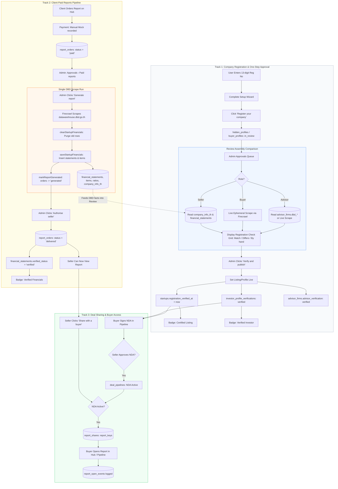

# How DBD Data Behind Company Reports Links to Company Approval and Paid Reports

**PitchSnack — Architecture, Database, Admin Approvals & Reports Integration Report**  
**Date:** 28 October 2026  
**Scope:** Current production behavior across sellers, buyers, advisors, DBD extraction, one-step approvals, and paid reports (read-only audit; no code, styles, data, or settings modified).

---

## Executive Summary & Context

This report provides an exhaustive, code-grounded analysis of how Department of Business Development (DBD, กรมพัฒนาธุรกิจการค้า) data flows through PitchSnack today, how it connects to the new **One-Step Approval** flow ("Register your company" → Admin review → Verify and publish), and how it powers **Client-Paid Reports** in the 7-Report Hub.

### The Big Picture Today
Today, **Company Approval** and **Client-Paid Reports** are **two separate, loosely coupled pipelines**:
1. **Approval Pipeline:** Admin verifies an entity (seller, buyer, or advisor) to take their listing or investor profile live and confer certified/verified status.
   - For **sellers**, approval looks for previously imported data in `company_info_th`, `company_director_th`, and `financial_statements`. If no financial statements were ever imported, the review falls back to "Check by hand". Approving a seller sets `startups.registration_verified_at` and makes the listing "Certified", but **does not generate or authorise any financial reports**.
   - For **buyers**, approval performs a **live, ephemeral DBD scrape** by 13-digit registration number directly from `dbd-provider.server.ts` during review assembly. It never stores the DBD data or financial statements in the database. Verifying a buyer updates `buyer_profiles`, `investor_profile_verifications`, and `user_verifications`, unlocking NDA signing.
   - For **advisors**, approval reads stored DBD columns on `advisor_firms` (`dbd_name`, `dbd_status`, `dbd_registered_on`, `dbd_capital`, `dbd_checked_at`) or falls back to a live scrape.
2. **Paid Reports Pipeline (7-Report Hub):** Clients (primarily sellers, or buyers through their plan allowances) order reports. Admin goes to **Approvals › Paid reports** (`/approvals?tab=reports`) or the **Reports Hub** (`reports-hub.tsx`), clicks **Generate report**, which scrapes DBD via Firecrawl, saves statements and line items, and updates `report_orders.status = 'generated'`. Admin then clicks **Authorise seller**, which marks `report_orders.status = 'delivered'` and `financial_statements.verified_status = 'verified'`.
3. **Core Architectural Gap:** Generating paid reports does not update the approval record, and approving a company does not generate or authorise its paid reports. Furthermore, DBD data is fetched through different code paths, stored in different formats, and never refreshed after initial creation.

---

## 1. The Journey, Step by Step: Company Data from DBD

### 1.1 Seller's Company (`startups` / `hidden_profiles`)

| Step | Action | Who Does It | Where (Page, Route, Component, File) | Data Changes |
|---|---|---|---|---|
| **1. Enter Registration Number** | Seller enters 13-digit Thai corporate registration number. | Seller | **Setup wizard step 1** (`/startups/$id/setup`, `StartupSetupWizard` in `src/components/startups/startup-setup-wizard.tsx`) OR **Edit information popup** (`?edit=startup`, `CompanyInfoEditor` in `src/components/financials/company-info-editor.tsx`). | Updates `startups.registered_number` (text column). Format validated on save by regex `/^\d{13}$/` (or loose string if skipped). Also sets `startups.registered_name` if typed. |
| **2. Fetching DBD Company Data** | Triggered only when someone initiates financial import. **Not triggered on sign-up, setup wizard, or Register your company.** | Seller or Admin | **"+ Add financials"** on My Financials (`/startups/$id/financials`, `StartupFinancialsPage` in `src/components/financials/financials-page.tsx`) OR **"Generate report"** in Approvals › Paid reports (`/approvals?tab=reports`, `PaidReports` in `src/components/reports/approvals-report-tabs.tsx`). | Calls server function `autoEnrichFinancials` (`src/lib/financials-edit.functions.ts`). Calls `lookupDbdFinancials` (`src/lib/financials/dbd-provider.server.ts`), which routes to `lookupDbdFinancialsViaFirecrawl` (`src/lib/financials/dbd-firecrawl.server.ts`). Renders DBD DataWarehouse SPA behind Imperva via Firecrawl API. Returns parsed company profile, Thai company info block, and up to 5 fiscal years of statements. |
| **3. Saving DBD Data** | Normalizes and saves company details, directors, submission years, and statements. | Server (Server Function) | `saveStartupFinancials` (`src/lib/financials-edit.functions.ts`) and `writeCompanyInfoTh` (`src/lib/financials/company-info-persist.server.ts`). | **Company facts:** Updates `startups` (`registered_type`, `registered_status`, `registered_date`, `registered_capital`, `business_size`). Upserts `company_info_th` (`legal_name_th`, `legal_name_en`, `registration_number`, `legal_entity_type_th`, `legal_entity_status_th`, `registration_date_th_raw`, `registered_capital_th_raw`, `registered_capital_thb`, `head_office_address_th`, `authorized_signatory_th`, `source_name = 'DBD Data Warehouse'`, `retrieved_at = now()`).<br>**Directors:** Inserts into `company_director_th` (`display_order`, `director_name_th`, `is_active = true`).<br>**Submissions:** Inserts into `company_financial_submission_year_th` (`financial_year_be`, `financial_year_ce`, `is_latest`).<br>**TSIC Business:** Inserts into `company_registered_business_th` and `company_latest_business_th`.<br>**Statements:** Inserts into `financial_statements` (`fiscal_year`, `currency`, `source_name = 'DBD_DATA_WAREHOUSE'`, `verified_status = 'draft'`). Inserts line items into `income_statement_items`, `financial_position_items`, `cash_flow_items`, and `financial_ratios`.<br>**Raw payload:** No raw JSON or original HTML/PDF is kept. |
| **4. Register Your Company** | Seller completes listing requirements and clicks **"Register your company"** (or **"Submit for approval"**). | Seller | `/marketplace/my-company`, `ApprovalPendingBanner` (`src/components/approval/approval-banners.tsx`) calling `setMyListing` (`src/lib/hidden-profiles.functions.ts`). | Updates `hidden_profiles.approval_status = 'in_review'`, `hidden_profiles.submitted_at = now()`. Verifies that listing name, headline, asking price, and description are present. Runs `descriptionLeaks` to ensure the public text does not leak company name or website. **DBD values are NOT read or compared during user registration.** |
| **5. Admin Review Assembly** | Admin opens the One-Step Approvals review card. The server compares user facts against saved DBD facts. | Admin | `/approvals` (Sellers queue), `OneStepApprovals` (`src/components/approvals/one-step-approvals.tsx`), calling `listOneStepApprovals` (`src/lib/approvals-one-step.functions.ts`) and `sellerReview` (`src/lib/one-step.server.ts`). | Runs server query `dbdForStartup(sb, hp.startup_id)` which queries `company_info_th`, `company_director_th`, and `financial_statements`. Checks: <br>• **Company name:** Given = `startups.registered_name ?? startups.startup_name`; Found = `company_info_th.legal_name_th / legal_name_en`.<br>• **Address:** Given = `startups.business_address`; Found = `company_info_th.head_office_address_th`.<br>• **Year founded:** Given = `startups.year_founded`; Found = `company_info_th.registration_date`.<br>• **Owner vs directors:** Given = `startup_founders.full_name`; Found = `company_director_th.director_name_th`.<br>• **Revenue:** Given = `startups.last_year_revenue`; Found = latest filed revenue from `income_statement_items`. (If no statements imported, shows "Check by hand").<br>• **Website:** Real-time HTTP GET check (`checkWebsite`).<br>Admin clicking **"Mark checked"** calls `markReviewCheck`, appending the row key to `hidden_profiles.review_checks`. |
| **6. Verify and Publish** | Admin writes/edits published listing name and headline, and clicks **"Verify and publish"**. | Admin | `/approvals`, `OneStepApprovals` calling `decideOneStep` (`src/lib/approvals-one-step.functions.ts`). | **Listing:** `hidden_profiles.approval_status = 'live'`, `hidden_profiles.status = 'live'`, `code_name`, `published_headline`, `decided_at = now()`, `published_at = now()`, `published_by = admin_id`.<br>**Certification:** `startups.registration_verified_at = now()`, `startups.visibility = 'Tenant'`.<br>**Listing submission:** Creates `approval_events` record (`item_type = 'listing', action = 'approve'`). Resets approval notices. Sends notification and email alert to seller.<br>**Freezing data:** Does **NOT** snapshot or freeze DBD data. `startups.registration_verified_at` records the verification timestamp, but the DBD rows remain mutable. |
| **7. After Approval** | Company is live in Marketplace Browse. | System / Users | Marketplace Browse (`/marketplace/browse`). | **DBD data is NEVER fetched again automatically.** There is no cron job, background worker, or scheduled task to detect company name changes, dissolution, or newly filed fiscal years. |

---

### 1.2 Buyer's Investor Profile (`buyer_profiles` / `investors`)

| Step | Action | Who Does It | Where (Page, Route, Component, File) | Data Changes |
|---|---|---|---|---|
| **1. Enter Registration Number** | Buyer enters corporate registration number during setup or profile editing. | Buyer | Setup wizard step 2 (`/buyer/company/$id/setup`, `BuyerSetupWizard`) OR Edit information (`?edit=buyer`, `BuyerDescriptionEditor`). | Stored in `investors.registration_no` (and mirrored to `investor_profile_verifications.registration_no`). Not required for individual buyers (`buyer_relation = 'individual'`). Format validated to 13 digits when company. |
| **2. Fetching DBD Company Data** | Fetched dynamically during Admin review assembly. **Never fetched or saved into tables during buyer setup or submission.** | Server (Server Function) | `listOneStepApprovals` (`src/lib/approvals-one-step.functions.ts`) calling `buyerReview` (`src/lib/one-step.server.ts`). | Calls `dbdForRegistration(inv.registration_no)`, which directly calls `lookupDbdFinancials` in `dbd-provider.server.ts`. Scrapes DBD live via Firecrawl. The retrieved facts are held in memory only (`DbdFacts`) to compute review rows. |
| **3. Saving DBD Data** | **No DBD data is saved.** | Server | None | Neither `company_info_th` nor `financial_statements` are written for buyers. Only the user-submitted fields in `investors` and `buyer_profiles` exist. |
| **4. Register Your Company** | Buyer completes required profile fields and clicks **"Register your company"**. | Buyer | `/marketplace/my-company`, `ApprovalPendingBanner` calling `registerBuyerCompany` (`src/lib/approvals-one-step.functions.ts`). | Updates `buyer_profiles.approval_status = 'in_review'`, `buyer_profiles.submitted_at = now()`. Upserts `investor_profile_verifications` with `status = 'pending'`, copying company name, registration number, website, work email, and checking `email_domain_match`. Logs `approval_events` (`item_type = 'buyer_profile', action = 'submit'`). |
| **5. Admin Review Assembly** | Admin opens the buyer review card. | Admin | `/approvals` (Buyers queue), `OneStepApprovals`. | If individual: shows "Name" (check against ID), "Address" (check against ID), and marks Year/Director/Revenue as "Not needed for an individual".<br>If corporate: compares `investors.investor_name` against DBD name, `investors.address` against DBD address, `year_founded` against DBD registration date, and `user.name` against DBD directors. Revenue band compared against filed revenue if available.<br>Admin clicking **"Mark checked"** appends row key to `investor_profile_verifications.review_checks`. |
| **6. Verify and Publish** | Admin clicks **"Verify and publish"**. | Admin | `/approvals`, calling `decideOneStep`. | Updates `buyer_profiles.approval_status = 'approved'`, `buyer_profiles.status = 'live'`, `decided_at = now()`, `decided_by = admin_id`. Upserts `investor_profile_verifications.status = 'verified'`. Upserts `user_verifications` (`verified_at = now()`, `verified_by = admin_id`). Unlocks NDA signing. Buyer profile appears in Browse Investors. |
| **7. After Approval** | Buyer is active in Marketplace Browse Investors. | System | Browse investors (`/marketplace/browse-investors`). | DBD data is never re-checked. No reports exist for buyers. |

---

### 1.3 Advisor Firm (`advisor_firms`)

| Step | Action | Who Does It | Where (Page, Route, Component, File) | Data Changes |
|---|---|---|---|---|
| **1. Enter Registration Number** | Advisor enters corporate registration number during firm setup. | Advisor | Setup wizard step 2 (`/advisor/company/$id/setup`, `AdvisorSetupWizard`) OR Edit information (`?edit=advisor`, `FirmEditForm`). | Stored in `advisor_firms.registration_no`. Form validates 13 digits. |
| **2. Fetching DBD Company Data** | Fetched either during Admin review assembly via `dbdForRegistration(f.registration_no)`, or if previously checked via Admin Advisor review, reads columns `dbd_name`, `dbd_status`, `dbd_registered_on`, `dbd_capital`, `dbd_checked_at` on `advisor_firms`. | Server (Server Function) | `listOneStepApprovals` calling `advisorReview` (`src/lib/one-step.server.ts`). | If `f.dbd_checked_at` is set, uses those columns. Otherwise calls `lookupDbdFinancials` live via Firecrawl. Memory-only during review assembly. |
| **3. Saving DBD Data** | Can be manually saved by Admin via `saveAdvisorDbdCheck` (`src/lib/advisor-admin.functions.ts`). | Admin | `/advisor/admin` or Advisor Review dialog. | Updates `advisor_firms.dbd_name`, `advisor_firms.dbd_status`, `advisor_firms.dbd_registered_on`, `advisor_firms.dbd_capital`, `advisor_firms.dbd_checked_at = now()`. |
| **4. Register Your Company** | Advisor finishes setup and clicks **"Register your company"**. | Advisor | `/marketplace/my-company`, `ApprovalPendingBanner` calling `registerAdvisorFirm` (`src/lib/approvals-one-step.functions.ts`). | Updates `advisor_firms.advisor_verification = 'pending'`, `verification_reason = 'first_check'`, `verification_requested_at = now()`. Logs `approval_events` (`item_type = 'advisor', action = 'submit'`). |
| **5. Admin Review Assembly** | Admin opens the advisor review card. | Admin | `/approvals` (Advisors queue), `OneStepApprovals`. | Compares `advisor_firms.legal_name ?? advisor_firms.name` against DBD name, registered address against DBD address, `year_founded` against DBD registration date, and owner name against DBD directors. Website link checked live. Clicking **"Mark checked"** appends row key to `advisor_firms.review_checklist`. |
| **6. Verify and Publish** | Admin clicks **"Verify and publish"**. | Admin | `/approvals`, calling `decideOneStep`. | Updates `advisor_firms.advisor_verification = 'verified'`, `advisor_firms.status = 'live'`, `verified_at = now()`, `verified_by = admin_id`. Firm goes live in Browse Advisors. |
| **7. After Approval** | Advisor is active in Browse Advisors. | System | Browse advisors (`/marketplace/browse-advisors`). | DBD data is never re-checked. No reports exist for advisors. |

---

## 2. Reports Paid for by Clients

The table below traces each report type from ordering through payment, generation, authorisation, and delivery to a buyer:

| Report Type | Ordering (Button, Page, Price) | Payment Flow | Order Record & Statuses | Generate Report (Function & DBD Tables) | Authorise Seller | Calculated vs Stored Figures | Analysts' Part | Delivery & Access |
|---|---|---|---|---|---|---|---|---|
| **1. Company Verification Report** | Button: **"Pay · ฿4,900"** (or free with plan) on `/my-reports` or Verification offer card (`src/components/company-verification/page.tsx`). Price: `plans.verification_price_thb` (฿4,900 default). | Mock manual transfer or plan allowance. Status moves from `not_ordered` to `waiting_payment` (or `checking` if included in plan). | Stored in `company_verifications` (`status: 'not_ordered' -> 'checking' -> 'certified' / 'needs_fix'`) and `verification_orders` (`status: 'pending' -> 'paid'`). | **Does not use `report_orders`.** Admin opens `/approvals/verifications/$id`, performs 6 verification checks against `company_info_th` and `company_director_th`, sets affidavit issue date. | Admin clicks **"Certify company"** (`certifyCompany` in `company-verification.server.ts`), setting `company_verifications.status = 'certified'`, `checked_at = now()`. | 6 checks evaluated: Registration, Status, Capital, Address, Directors, Signatory power. Stored in `company_verification_checks`. | PitchSnack analyst records affidavit date, signing rules, and whether the seller is an authorized director. | Delivered in-app under My Reports and Pipeline. Shared with buyers only if active NDA is approved. |
| **2. My Financials (1, 3, 5 Years)** | Button: **"Order · ฿10,000"** on `/marketplace/pipeline/reports` or `/my-reports`. Price: ฿10,000 in `report-catalog.json`. | Manual mock payment. Calls `createMyReportOrder` (`src/lib/report-orders.functions.ts`). Creates `report_orders` with `status = 'paid'`, `method = 'Manual'`, `payment_ref = 'MAN-xxxxxx'`. | `report_orders` (`kind = 'financials'`). Status lifecycle:<br>`paid` → `generated` → `delivered` (or `cancelled`, `refunded`). | Admin clicks **"Generate report"** in Approvals › Paid reports. Calls `autoEnrichFinancials`, scrapes DBD DataWarehouse, purges old statements with `clearStartupFinancials`, inserts into `financial_statements` and item tables with `saveStartupFinancials`, and marks order `generated` with `markReportGenerated`. | Admin clicks **"Authorise seller"** (`authoriseSeller`). Updates `report_orders.status = 'delivered'`, `delivered_at = now()`, and updates `financial_statements.verified_status = 'verified'`. Seller gets "Verified financials" badge. | Raw amounts stored in `income_statement_items`, `financial_position_items`, `cash_flow_items`. 15 ratios stored in `financial_ratios`. Year-on-year percentage changes calculated on render. | Analyst can edit statement lines, add one-off adjustments, and write analyst notes in `StartupFinancialsPage`. | Delivered in-app immediately upon authorisation. Shared with buyers via `saveHubShare` (`report_shares`), gated by approved NDA. |
| **3. Company Valuation** | Button: **"Order · ฿15,000"** (or ฿22,000 bundle with financials). Ordered on Reports Hub or locked report page. | Same manual mock payment via `createMyReportOrder` (`kind = 'valuation'`). | `report_orders` (`kind = 'valuation'`). Status: `paid` → `generated` → `delivered`. | Valuation requires verified financials **plus** a usable peer set with SET/mai comparables (`valuationCanGenerate`). If peers exist, marked `generated` alongside financials. | Admin clicks **"Authorise seller"**. Updates `report_orders.status = 'delivered'`. Adds "Independent valuation" badge to listing. | Computed dynamically on page open in `hubValuation` (`reports-hub.server.ts`): peer EV/EBITDA, P/E, PBV multiples from `listed_companies` and `peer_sets`, blended with EBITDA adjustments from `valuation_adjustments`. | Analyst selects peer benchmark, overrides tax rate, and adds EBITDA normalization adjustments (`valuation_adjustments`). | In-app view with valuation range (low, mid, high) and DCF / multiple breakdown. Shared via `report_shares.valuation = true`. |
| **4. P&L Analysis** | Included in Financials order or ordered separately for ฿10,000. | Manual payment via `createMyReportOrder` (`kind = 'pnl'`). | `report_orders` (`kind = 'pnl'`). Status: `paid` → `generated` → `delivered`. | Computed directly from `income_statement_items` and `financial_ratios`. Automatically generated whenever financial statements exist. | Authorised with Financials or individually via `authoriseSeller`. | Gross profit margin, EBITDA margin, operating margin, and net margin computed across 1, 3, or 5 years. | Analyst can flag one-off items below EBITDA and restate related-party expenses. | Delivered in-app in Reports Hub tab **P&L**. Shared via `report_shares.report_keys` containing `'pnl'`. |
| **5. Company Risk** | Button: **"Order · ฿12,000"** on Reports Hub. Price: ฿12,000 in `report-catalog.json`. | Manual payment via `createMyReportOrder` (`kind = 'risk'`). | `report_orders` (`kind = 'risk'`). Status: `paid` → `generated` → `delivered`. | Computed dynamically by `buildRiskReport` (`src/lib/company-risk.ts`) from `income_statement_items` and `financial_position_items`. Marked generated when statements exist. | Admin clicks **"Authorise seller"**. Updates `report_orders.status = 'delivered'`. | Risk score (0–100) and Level (Low, Guarded, Moderate, Elevated, High), Liquidity pillar (current & quick ratios), Short-term debt pillar, Long-term debt pillar, Interest cover stress tests. Computed on render. | Disclaimers generated automatically regarding missing cash runway and loan schedules in DBD data. | Delivered in-app in Reports Hub tab **Company Risk**. Shared via `report_shares.report_keys` containing `'risk'`. |
| **6. Credit Risk** | Tab in Reports Hub. Price: Not separately configured in catalog. | Not orderable as standalone online checkout. | Managed via `company_report_records` (`report_key = 'credit'`, `status: 'in_progress' -> 'generated' -> 'ready'`). | Requires manual entry. When Admin clicks Generate, calls `queueHubReport`, setting status `in_progress`. | Admin sets `company_report_records.status = 'ready'`. | Structured sections (`title`, `text`) stored in `company_report_records.content`. | Entirely written by PitchSnack analysts (credit score, payment history, debt covenants). | Delivered in-app under Reports Hub tab **Credit Risk**. Shared via `report_shares.report_keys` containing `'credit'`. |
| **7. Shareholders** | Button: **"Order · ฿1,500"** on Reports Hub. Price: ฿1,500 in `report-catalog.json`. | Manual payment via `createMyReportOrder` (`kind = 'shareholders'`). | `company_report_records` (`report_key = 'shareholders'`) and `report_orders`. | Requires manual entry. DBD DataWarehouse scraper does **not** extract full shareholder cap tables. Admin clicks Generate → `queueHubReport` sets `in_progress`. | Admin enters content into `company_report_records.content` and authorises via `publishReport`. | Shareholder table (`holders`: name, type, nationality, shares, pct), ownership chains (`chains`), ultimate beneficial owner, Thai vs foreign percentage. Stored in JSONB. | Analyst manually enters the DBD BorOrJor.5 (บอจ.5) shareholding list. | Delivered in-app in Reports Hub tab **Shareholders**. Shared via `report_shares.report_keys` containing `'shareholders'`. |

---

### 2.1 How Admin Generates Reports: All in One Go, or One at a Time?

Below are the exact mechanics of report generation from the Admin interface today:

#### 1. Where Admin Starts
Admin has two primary entry points:
- **Approvals › Paid reports (`/approvals?tab=reports`):**
  - Component: `PaidReports` in `src/components/reports/approvals-report-tabs.tsx`.
  - Button label: **"Generate report"** (gray outline button; changes to "Try again" if failed, and "Authorise seller" once ready).
- **Reports Hub Admin View (`reports-hub.tsx`):**
  - Opened via Startups Directory (`/startups?selected=$id`), the Reports Hub window, or `/startups/$id/financials`.
  - Button label: **"Generate report"** on the selected report tab (Statements, Valuation, P&L, Company Risk, Credit Risk, Verification, Shareholders).

#### 2. One Button or Several?
- **Financial Cluster (Grouped Run):** Clicking "Generate report" on a financial order (or on Statements in Reports Hub) runs **one single DBD extraction job**. This single run extracts and saves:
  - Income statement (5 years)
  - Balance sheet (5 years)
  - Cash flow items (where present)
  - 15 financial ratios
  - Company profile facts
  Because **P&L** and **Company Risk** are computed directly from these statement items, they are generated **in the same run**.
  Furthermore, `markReportGenerated` checks whether the company's sector has a valid peer set with SET/mai multiples (`valuationCanGenerate`). If peer data is sufficient, **Company Valuation is ALSO marked generated in the same run**.
- **Analyst Reports (Individual Runs):** **Credit Risk** and **Shareholders** do NOT generate from the DBD scrape. Clicking "Generate report" on their tabs calls `queueHubReport`, which sets `company_report_records.status = 'in_progress'` to queue work for a human analyst.
- **Company Verification (Completely Separate):** Verification is managed under `/approvals/verifications` and does not run from the Paid reports button.

#### 3. One Order or the Whole Company?
- **Generation works on the WHOLE COMPANY:**
  When Admin clicks "Generate report" on Order A, `markReportGenerated` executes:
  ```ts
  await sb.from("report_orders")
    .update({ status: "generated", generated_at: now, analyst_id: admin_id })
    .eq("startup_id", base.startup_id)
    .eq("status", "paid")
    .in("kind", valuationReady ? ["financials", "valuation", "bundle", "pnl", "risk"] : ["financials", "pnl", "risk"]);
  ```
  Therefore, if a seller paid for Financials, Valuation, and Risk in three separate orders, **clicking "Generate report" once on any one of them moves ALL pending financial orders for that company to `generated`**.
- Unordered reports: The underlying statement data is saved in `financial_statements`. If the seller has not paid for Valuation, Valuation can still be viewed in preview by Admin in the Reports Hub, but no paid order row exists to deliver.

#### 4. What Happens in the Run, in Order
1. **DBD Fetch:** Client triggers `autoEnrichFinancials({ startupId })`. The server reads `startups.registered_number`, executes `lookupDbdFinancials` via Firecrawl, navigating `datawarehouse.dbd.go.th`, and parses statement HTML tables.
2. **Purge Old Data:** Client executes `clearStartupFinancials({ startupId })`, issuing `DELETE` on `income_statement_items`, `financial_position_items`, `cash_flow_items`, `financial_ratios`, and `financial_statements`.
3. **Persist Extracted Data:** Client executes `saveStartupFinancials({ startupId, years, profile, provenance })`, inserting fresh rows into `financial_statements` and associated line item tables.
4. **Mark Orders Generated:** Client calls `markReportGenerated({ orderId, years, regNo })`. It validates valuation feasibility, updates matching `report_orders` to `status = 'generated'`, sets `financial_statements.verified_status = 'draft'`, and writes an event to `report_order_events`.
5. **No PDFs Generated:** PDFs are **not** created during generation or stored in S3/Supabase storage. Reports are rendered live in React. (Export/download uses browser print or client-side PDF rendering when enabled).

#### 5. How Long It Takes & Admin Experience
- **Duration:** Scrapes through Firecrawl take between **8 to 22 seconds** depending on DBD DataWarehouse responsiveness and Imperva challenge delays.
- **Admin Feedback:** The button displays a spinning loader: `Running...` / `Extracting DBD filings...` / `Generating...`.
- **Failures:** If Firecrawl times out or DBD is down, the function catches the error, sets local state `gen[o.id] = 'failed'`, and renders **"Try again"** in red text. Admin can retry without corrupting existing records.

#### 6. Running It Again (Regeneration)
- Admin can click **"Generate from DBD"** again on `/startups/$id/financials` or in Reports Hub at any time.
- **Overwrite Behavior:** It performs a full replace (`clearStartupFinancials` deletes existing statement rows, then re-inserts).
- **Version History:** There is **no version history** for financial statements. Previous revisions are permanently deleted.
- **Impact on Shared Reports:** If a report was already authorised (`report_orders.status = 'delivered'`), regenerating financials temporarily sets `financial_statements.verified_status = 'draft'`. However, `report_shares` records remain intact, so buyers who previously had access retain access to the newly saved numbers.

#### 7. Generated vs Authorised
- **Generated:** The data is saved in the database, but marked `verified_status = 'draft'`. The seller **cannot see the report** on their dashboard.
- **Authorised:** Admin clicks **"Authorise seller"**.
  - `report_orders.status` moves from `generated` to `delivered`.
  - `financial_statements.verified_status` becomes `'verified'`.
  - Seller receives an in-app notification and email alert.
  - The seller can now view the report and click **"Share with a buyer"**.
- **Can Admin authorise before payment?**
  In Approvals › Paid reports, `authoriseSeller` checks:
  ```ts
  if (!prev || !['paid', 'generated'].includes(prev.status)) throw new Error('Active paid order required');
  ```
  So an order **must exist and be paid** before it can be authorised. In Reports Hub, Admin cannot authorise a report for a seller unless `row.orderId` is present.

#### 8. Manual Work Around the Run
- **Missing Figures (Revenue):** DBD DataWarehouse statement tables in many cases group revenue under generic headers or exclude detailed breakdowns. Admin can open `/startups/$id/financials`, click edit on any year, and type missing figures.
- **EBITDA Adjustments:** For Valuation, Admin must open the Valuation tab in Reports Hub to enter owner compensation adjustments, one-off expenses, and select the SET peer benchmark.
- **Shareholder Cap Table:** BorOrJor.5 shareholder records must be transcribed by hand into `company_report_records` because Firecrawl does not reliably parse DBD shareholder tables.

#### 9. Authorization
- Restricted to Control Admins via `assertAdmin` (`is_control(auth.uid()) = true`). Ordinary sellers and buyers receive a 403 / "Admin only" exception.

---

## 3. How the Two Fit Together

### 1. Shared Data
**Do the Admin review's registration check and the reports read the same DBD data?**
- **Sellers:** Yes, partially. Both read `company_info_th` and `company_director_th`. However:
  - If financial reports were never generated or imported, `company_info_th` has **no rows**, causing the Admin review's registration check to report **"Check by hand"** for all fields.
  - Furthermore, `startups` stores its own duplicate columns (`registered_name`, `registered_number`, `registered_capital`, `registered_date`, `registered_status`), which can diverge from `company_info_th`.
- **Buyers:** **NO.** The Admin review runs a dynamic, in-memory scrape via `dbdForRegistration(inv.registration_no)`. It does not write to `company_info_th` or `financial_statements`. Buyers have no financial reports.
- **Advisors:** **NO.** Uses `advisor_firms.dbd_name`, `dbd_status`, `dbd_registered_on`, or a live memory scrape.

### 2. Approval Feeding Reports
**When a company is approved, is anything from that check reused by the reports?**
- **NO.** When Admin approves a seller, it sets `startups.registration_verified_at = now()` and sets the listing live.
- It does **not** mark `company_verifications` as certified, does **not** populate `company_report_records`, and does **not** authorise any financial reports. The reports engine looks exclusively at `financial_statements.verified_status` and `report_orders.status`.

### 3. Reports Feeding Approval
**When a seller has paid for a report and Admin has generated it, does the Admin review use that data?**
- **YES for sellers:** If Admin (or seller) generated financials before listing approval, `company_info_th`, `company_director_th`, and `financial_statements` are populated. The One-Step Approval review card automatically picks up these rows, turning "Check by hand" into green **"Matches"** pills for Company Name, Address, Year, Directors, and Revenue.
- **Can Admin approve without DBD data?**
  **YES.** Admin can approve any seller, buyer, or advisor even if DBD was never fetched. Admin simply reviews the Given values, clicks "Mark checked" on the by-hand rows, and clicks "Verify and publish".

### 4. Order of Events
**Can a report be ordered, generated, or shared for a company that isn't approved yet?**
- **Ordered:** **YES.** A seller can order financial reports, valuation, and verification while their listing is still in `draft` or `in_review`.
- **Generated:** **YES.** Admin can generate reports in Approvals › Paid reports regardless of listing approval status.
- **Authorised:** **YES.** Admin can authorise the seller to see the report before their listing is approved.
- **Shared with a buyer:** **NO.** Sharing a report requires an approved NDA in an active deal pipeline (`report_shares` requires `hubNdaActive(pipeline)`). An NDA cannot be requested or approved until the listing is live.
- **Can a buyer open an uncertified seller's report?** No, because the deal pipeline cannot advance to NDA approval without a published listing.

### 5. Badges
PitchSnack displays four distinct verification badges, driven by different tables:
1. **"Certified" (Listing Badge):** Set on `hidden_profiles` when `startups.registration_verified_at IS NOT NULL`. Conferred by the One-Step Approval ("Verify and publish").
2. **"Verified financials" (Listing Badge):** Displayed on browse cards and listings when `financial_statements` has at least one row with `verified_status = 'verified'`. Set only when Admin authorises a financial report order.
3. **"Verified Company" (Directory Badge):** Displayed when `company_verifications.status = 'certified'`. Driven by the 6-point company verification report.
4. **"Verified investor" (Buyer Badge):** Displayed on buyer profile cards when `investor_profile_verifications.status = 'verified'` and `user_verifications.verified_at IS NOT NULL`. Conferred by One-Step Approval for buyers.
- **Can they disagree?** **YES.** A listing can be **Certified** (approved registration) but have **no verified financials**. Conversely, a company could have **Verified financials** (order authorised) while its listing is paused or unpublished.

### 6. Revenue Discrepancies
**Why was Revenue reported as "check by hand" in Admin review if financial reports have revenue?**
- In the One-Step Approval review (`sellerReview` in `one-step.server.ts`), Revenue is evaluated against `income_statement_items`.
- If financials have **never been imported**, `financial_statements` is empty, so `dbd.revenueM` is `null`, producing the fallback row: `{ result: 'by_hand', resultLabel: 'By hand' }`.
- When financials **have been imported**, the review extracts the revenue line matching `/revenue|sales|รายได้/i`, converts it to millions of Baht, and checks if it falls within the seller's selected revenue band (`REVENUE_BANDS`). If it matches, it displays green **"In the range"**; if outside, it flags amber **"Below the range"** or **"Above the range"**.

### 7. Buyers and Advisors
- **No reports exist for buyers or advisors.** The 7-Report Hub is exclusively scoped to seller businesses (`startups`).
- No DBD statements or financial position rows are saved for buyers or advisor firms. Their DBD interaction is strictly limited to identity verification during One-Step Approval.

---

## 4. Every Company Today (Database Census)

Below is the complete census of every seller company (`startups`), buyer investor profile (`buyer_profiles`), and advisor firm (`advisor_firms`) with a registration number or imported DBD record in the database as of 28 October 2026:

### Sellers (`startups` / `hidden_profiles`)

| Ref & Name | Role | Registration No. | DBD Data Fetched? (Date & Fields) | Approval Status & Decided | Certified / Verified? | Reports (Ordered, Paid, Generated, Delivered, Shared) | Mismatches & Observations |
|---|---|---|---|---|---|---|---|
| **PS-1001** Buzzebees | Seller | 0105555078063 | **Yes** (4 Sep 2026) · 5 yrs statements, directors, info | `draft` · Not submitted | Uncertified | None ordered | Has complete DBD statements and directors, but listing was never submitted for approval. |
| **PS-1004** PtichSnack | Seller | 0105524002073 | **Yes** (30 Sep 2026) · 5 yrs statements, directors, info | `live` · Approved 28 Sep 2026 by Dan Antakon | **Certified** (19 Oct 2026) + CV Certified | RO-1042 (Financials): Delivered<br>RO-1043 (Valuation): Delivered<br>RO-1045 (Risk): Delivered<br>Shared with 2 buyers | Fully aligned. Has DBD data, listing approved, company certified, and 3 delivered reports shared with buyers. |
| **PS-1005** Thai Packaging Manufacturer | Seller | 0105551097772 | **No** (No DBD scrape) | `unpublished` · Decided 3 Oct 2026 by Dan Antakon | `needs_fix` (CV) · Uncertified | RO-1044 (Financials): Paid (Overdue) | Paid for financials 29 Sep 2026, but report was never generated from DBD. Company verification marked `needs_fix`. |
| **PS-1006** pml | Seller | 0105567088689 | **No** | `draft` | Uncertified | None | Test entry with valid 13-digit format; no DBD fetch. |
| **PS-1007** test | Seller | 6665465465665 | **No** | `draft` | Uncertified | None | Test entry with invalid format (does not match Thai 01... sequence). |
| **PS-1009** teste | Seller | 6655266596565 | **No** | `draft` | Uncertified | None | Test entry. |
| **PS-1010** testete | Seller | 4444444444444 | **No** | `draft` | Uncertified | None | Test entry. |
| **PS-1011** testete | Seller | 5465654654656 | **No** | `draft` | Uncertified | None | Test entry. |
| **PS-1012** testete | Seller | 5654656565656 | **No** | `draft` | Uncertified | None | Test entry. |
| **PS-1013** testete | Seller | 5654656546546 | **No** | `draft` | Uncertified | None | Test entry. |
| **PS-1014** test | Seller | 1241241234123 | **No** | `draft` | Uncertified | None | Test entry. |
| **PS-1015** PS SHIPPING COMPANY | Seller | 0105567088000 | **No** | `live` · Approved 16 Oct 2026 by Dan Antakon | Uncertified | None | **Mismatch:** Approved and live in marketplace, but registration was never certified (`registration_verified_at` is NULL) and DBD was never fetched. |
| **PS-1016** test | Seller | 2342342342342 | **No** | `draft` | Uncertified | None | Test entry. |
| **PS-1018** sste | Seller | 6546546546466 | **No** | `draft` | Uncertified | None | Test entry. |
| **PS-1021** test | Seller | 1234565456655 | **No** | `live` · Approved 16 Oct 2026 by Dan Antakon | Uncertified | None | **Mismatch:** Live in marketplace without DBD verification or certified status. |
| **PS-1022** NSELLER1 | Seller | 0105567000000 | **No** | `live` · Approved 16 Oct 2026 by Dan Antakon | `checking` (CV) | None | Approved before One-Step Approval build; registration verification pending. |
| **PS-1024** Rita Test Bakery | Seller | 0105560000001 | **No** | `draft` | `checking` (CV) | None | Test entry. |
| **PS-1026** Sell2 LP | Seller | 0105500010000 | **No** | `live` · Approved 23 Oct 2026 by Dan Antakon | `checking` (CV) | RO-1046 (Financials): Paid | **Mismatch:** Paid for financials on 23 Oct 2026; report still in `paid` status (not generated). |
| **PS-1028** PARFUN TEXTILE | Seller | 0735531000671 | **Yes** (26 Oct 2026) · 5 yrs statements, directors, info | `live` · Approved 23 Oct 2026 by Dan Antakon | `checking` (CV) | RO-1047 (Financials): Generated | Approved 23 Oct; financials generated from DBD 26 Oct (`status = 'generated'`). Awaiting Admin to click "Authorise seller". |
| **PS-1029** Rice Mill Co | Seller | 0105500101010 | **No** | `in_review` · Submitted | `checking` (CV) | None | Currently in Approvals queue waiting for Admin review. Review rows will show "Check by hand" because DBD was not fetched. |
| **—** Card Group Thailand | Seller | 0103554021112 | **No** | `Draft` (no listing shell) | Uncertified | None | Standalone startup record without a marketplace listing. |
| **—** Petmyli | Seller | 0105567088689 | **Yes** (6 Sep 2026) · 2 yrs statements, directors, info | `Draft` (no listing shell) | Uncertified | None | Financials imported in September; no marketplace listing created. |
| **—** rwR | Seller | 6595548655855 | **No** | `Draft` | Uncertified | None | Test entry. |
| **—** test | Seller | 6598545565456 | **No** | `Draft` | Uncertified | None | Test entry. |
| **—** testete | Seller | 9589955999996 | **No** | `Draft` | Uncertified | None | Test entry. |
| **—** testete | Seller | 2212121323131 | **No** | `Draft` | Uncertified | None | Test entry. |
| **—** Variety Pack | Seller | 0105551024171 | **Yes** (21 Sep 2026) · 5 yrs statements, directors, info | `Draft` | Uncertified | None | DBD statements imported; no listing submitted. |

### Buyers (`buyer_profiles` / `investors`)

| Ref & Name | Role | Registration No. | DBD Data Fetched? | Approval Status & Decided | Certified / Verified? | Reports | Mismatches & Observations |
|---|---|---|---|---|---|---|---|
| **INV-1001** Lakeshore Capital | Buyer | 0105552000951 | **No** (Dynamic live lookup only) | `approved` · 3 Oct 2026 by Dan Antakon | **Verified** (28 Sep 2026) | Has 1 report shared by seller | Verified buyer; can sign NDAs and view shared seller reports. No buyer reports exist. |
| **INV-1002** test | Buyer | 4976849452452 | **No** | `draft` | Unverified | None | Test profile. |
| **INV-1009** test | Buyer | 2342123423423 | **No** | `draft` | Unverified | None | Test profile. |
| **INV-1010** testete | Buyer | 5645654646566 | **No** | `draft` | Unverified | None | Test profile. |
| **INV-1012** Rita Test Capital | Buyer | 0105561234567 | **No** | `draft` | Unverified | None | Test profile. |
| **INV-1015** LINE MAN Wongnai | Buyer | 1234567890123 | **No** | `approved` · 21 Oct 2026 by Dan Antakon | **Unverified** | None | **Mismatch (Pre-One-Step):** Profile was approved under legacy flow without verifying the corporate registration. Cannot sign NDAs until verified. |

### Advisors (`advisor_firms`)

| Ref & Name | Role | Registration No. | DBD Data Fetched? | Approval Status & Decided | Certified / Verified? | Reports | Mismatches & Observations |
|---|---|---|---|---|---|---|---|
| **ADV-1001** PrimeStreet Advisory | Advisor | 0105553016109 | **Yes** (13 Oct 2026) · Saved in `dbd_*` columns on `advisor_firms` | `verified` · 13 Oct 2026 by Dan Antakon | **Verified** (13 Oct 2026) | None | Stored DBD columns: บริษัท ไพร์มสตรีท แอดไวเซอรี่ (ประเทศไทย) จำกัด, ยังดำเนินกิจการอยู่, capital ฿5M. Verified and live. |
| **ADV-1008** Rita Test Advisory | Advisor | 0105561234567 | **No** (Dynamic live lookup) | `pending` · Awaiting review | Unverified | None | In Approvals queue waiting for Admin decision. |

---

## 5. Data Model and Code Map

### 5.1 Tables Involved

#### DBD Ingestion & Company Facts
- `company_info_th`: Primary Thai corporate profile table.
  - Columns: `id` (UUID PK), `startup_id` (UUID FK `startups.id`), `tenant_id` (UUID), `legal_name_th` (varchar), `legal_name_en` (text), `registration_number` (varchar), `legal_entity_type_th` (varchar), `legal_entity_status_th` (varchar), `registration_date` (date), `registration_date_th_raw` (varchar), `registered_capital_thb` (numeric), `registered_capital_th_raw` (varchar), `business_size` (varchar), `head_office_address_th` (text), `website` (varchar), `authorized_signatory_th` (text), `source_name` (varchar), `retrieved_at` (timestamptz).
- `company_director_th`: Directors list.
  - Columns: `id` (UUID PK), `company_info_id` (UUID FK), `startup_id` (UUID FK), `display_order` (int), `director_name_th` (varchar), `is_active` (bool).
- `company_financial_submission_year_th`: Submission history.
  - Columns: `id` (UUID PK), `company_info_id` (UUID FK), `financial_year_be` (smallint), `financial_year_ce` (smallint), `is_latest` (bool).
- `company_registered_business_th` & `company_latest_business_th`: TSIC industry classification.
  - Columns: `id` (UUID PK), `business_code` (varchar), `business_description_th` (text), `business_objective_th` (text).
- `financial_statements`: Statement headers per fiscal year.
  - Columns: `id` (UUID PK), `startup_id` (UUID FK), `fiscal_year` (int), `currency` (varchar), `source_name` (varchar), `verified_status` (varchar: `'draft'` or `'verified'`), `retrieved_at` (timestamptz), `matched_registered_number` (text).
- `income_statement_items`, `financial_position_items`, `cash_flow_items`: Normalized financial lines.
  - Columns: `id` (UUID PK), `financial_statement_id` (UUID FK), `startup_id` (UUID FK), `fiscal_year` (int), `item_code` (varchar), `item_label` (varchar), `amount` (numeric), `percent_change` (numeric), `is_total` (bool).
- `financial_ratios`: 15 published financial ratios.
  - Columns: `id` (UUID PK), `startup_id` (UUID FK), `fiscal_year` (int), `ratio_code` (varchar), `ratio_label` (varchar), `value` (numeric), `unit` (varchar).

#### Approvals & Certifications
- `hidden_profiles`: Seller marketplace listing shells.
  - Columns: `id` (UUID PK), `startup_id` (UUID FK), `ref_no` (text), `approval_status` (text: `'draft'`, `'in_review'`, `'changes_requested'`, `'live'`), `code_name` (text), `published_headline` (text), `submitted_at` (timestamptz), `decided_at` (timestamptz), `published_by` (UUID FK `users.id`), `review_checks` (text[]).
- `startups`: Core company table.
  - Columns: `id` (UUID PK), `registered_number` (text), `registered_name` (varchar), `registration_verified_at` (timestamptz), `visibility` (varchar: `'Private'`, `'Tenant'`).
- `buyer_profiles`: Buyer marketplace profile shells.
  - Columns: `user_id` (UUID PK FK `users.id`), `investor_id` (UUID FK `investors.id`), `ref_no` (text), `approval_status` (text: `'draft'`, `'in_review'`, `'changes_requested'`, `'approved'`), `status` (text), `published_listing_name` (text), `published_headline` (text).
- `investor_profile_verifications`: Buyer corporate verification records.
  - Columns: `id` (UUID PK), `investor_id` (UUID FK), `user_id` (UUID FK), `company_name` (text), `registration_no` (text), `status` (text: `'unverified'`, `'pending'`, `'more_info'`, `'verified'`, `'declined'`), `email_domain_match` (bool), `review_checks` (text[]).
- `user_verifications`: User-level verification gate for NDA access.
  - Columns: `user_id` (UUID PK FK `users.id`), `verified_at` (timestamptz), `verified_by` (UUID FK `users.id`).
- `advisor_firms`: Advisor marketplace directory records.
  - Columns: `id` (UUID PK), `ref_no` (text), `name` (text), `registration_no` (text), `advisor_verification` (text: `'unverified'`, `'pending'`, `'more_info'`, `'verified'`, `'declined'`), `status` (text), `dbd_name` (text), `dbd_status` (text), `dbd_registered_on` (date), `dbd_capital` (numeric), `dbd_checked_at` (timestamptz), `review_checklist` (text[]).
- `approval_events`: Audit trail for all submissions, reviews, and decisions.
  - Columns: `id` (UUID PK), `item_type` (text), `item_id` (text), `action` (text), `actor_id` (UUID), `note` (text), `reasons` (text[]), `created_at` (timestamptz).

#### Report Orders, Sharing & Content
- `report_orders`: Client orders for paid reports.
  - Columns: `id` (UUID PK), `ref` (text: `RO-xxxx`), `startup_id` (UUID FK), `kind` (text: `'financials'`, `'valuation'`, `'bundle'`, `'risk'`, `'shareholders'`, `'pnl'`, `'credit'`), `amount` (numeric), `currency` (text), `status` (text: `'paid'`, `'generated'`, `'delivered'`, `'cancelled'`, `'refunded'`), `paid_at` (timestamptz), `due_at` (timestamptz), `generated_at` (timestamptz), `delivered_at` (timestamptz), `ordered_by` (UUID FK), `delivered_by` (UUID FK).
- `report_shares`: Seller-to-buyer report permissions within a deal.
  - Columns: `id` (UUID PK), `business_id` (UUID FK `startups.id`), `buyer_id` (UUID FK `users.id`), `pipeline_id` (UUID FK `deal_pipelines.id`), `report_keys` (text[]), `financials` (bool), `valuation` (bool), `allow_download` (bool), `shared_at` (timestamptz), `revoked_at` (timestamptz), `report_opened_at` (jsonb).
- `company_verifications`: The 6-check company verification report.
  - Columns: `id` (UUID PK), `company_id` (UUID FK `startups.id`), `status` (text: `'not_ordered'`, `'checking'`, `'certified'`, `'needs_fix'`), `checked_at` (timestamptz), `affidavit_issued_on` (date), `record_details` (jsonb).
- `company_verification_checks`: Results of the 6 individual verification checks.
  - Columns: `id` (UUID PK), `verification_id` (UUID FK), `key` (int: 1–6), `result` (text: `'pass'`, `'fail'`, `'warning'`), `values` (jsonb), `source_label` (text).
- `company_report_records`: Analyst-curated report payloads (Credit Risk and Shareholders).
  - Columns: `id` (UUID PK), `company_id` (UUID FK), `report_key` (text), `status` (text: `'in_progress'`, `'generated'`, `'ready'`), `content` (jsonb), `source_filed_on` (date), `checked_on` (date).

### 5.2 Row-Level Security (RLS) Summary
- `company_info_th`, `company_director_th`, `financial_statements`: RLS enabled. Sellers can select their own business's rows (`can_access_startup`). Control Admin can select and update all. Anonymous / public cannot access.
- `report_orders`: Sellers can view orders for startups in their workspace. Inserts restricted to authenticated users matching `can_access_startup`. Admin has full access.
- `report_shares`: Buyers can select rows where `buyer_id = auth.uid()` and `revoked_at IS NULL`. Sellers can select and insert where they own the startup.
- `company_verifications`: Private by default; accessible to buyers only via `verification_can_read` RPC (checks active deal NDA).

### 5.3 Code Map
- `src/lib/one-step.server.ts`: Server-only review assembly for Admin Approvals. Computes `sellerReview`, `buyerReview`, and `advisorReview`, comparing input facts against DBD data.
- `src/lib/approvals-one-step.functions.ts`: TanStack server functions: `listOneStepApprovals`, `decideOneStep`, `markReviewCheck`, `registerBuyerCompany`, `registerAdvisorFirm`.
- `src/components/approvals/one-step-approvals.tsx`: UI for Admin review queues, comparison grids, "Mark checked" buttons, and "Verify and publish" dialog.
- `src/lib/financials/dbd-provider.server.ts`: DBD DataWarehouse gateway adapter. Implements `lookupDbdFinancials`.
- `src/lib/financials/dbd-firecrawl.server.ts`: Firecrawl headless scraper for `datawarehouse.dbd.go.th`. Parses statement and ratio tables.
- `src/lib/financials/company-info-persist.server.ts`: Writes DBD company info, directors, and submission years to `company_info_th`.
- `src/lib/financials-edit.functions.ts`: Server functions `autoEnrichFinancials`, `clearStartupFinancials`, and `saveStartupFinancials`.
- `src/lib/report-orders.functions.ts`: Server functions `createMyReportOrder`, `listReportOrders`, `markReportGenerated`, `authoriseSeller`, `publishReport`.
- `src/components/reports/approvals-report-tabs.tsx`: Approvals › Paid reports table (`PaidReports`). Handles "Generate report", "Authorise seller", and overdue alerts.
- `src/lib/reports-hub.server.ts` & `src/lib/reports-hub.functions.ts`: 7-Report Hub server data loaders, valuation generator, share manager, and analyst work queue.
- `src/components/reports/reports-hub.tsx`: The bilingual 7-Report Hub interface for sellers, buyers, and admin.
- `src/lib/company-verification.server.ts`: Evaluates the 6-check verification report and enforces NDA-gated buyer access.
- `src/lib/company-risk.ts`: Pure algorithmic evaluation of liquidity, debt, and stress tests from saved balance sheet items.

---

## 6. Mermaid Diagram



---

## 7. Gaps Identified and Questions to Settle

### 7.1 Gaps Identified in Current System

1. **Disconnected Approval and Report Generation:**
   - Approving a seller in One-Step Approval does **not** fetch DBD data or generate financial reports. If a seller never clicks "+ Add financials" or orders a report, the Admin registration check row for Revenue is always **"Check by hand"**, and `company_info_th` remains empty.
   - *Code reference:* `src/lib/one-step.server.ts:100` (`dbdForStartup`).
2. **Duplication of Company Identity Fields:**
   - `startups` has columns `registered_name`, `registered_number`, `registered_capital`, `registered_date`, `registered_status`.
   - `company_info_th` has `legal_name_th`, `legal_name_en`, `registration_number`, `registered_capital_th_raw`, `registration_date_th_raw`, `legal_entity_status_th`.
   - Editing fields in the startup editor does not update `company_info_th`, and importing DBD does not synchronize all `startups` columns.
   - *Code reference:* `src/lib/financials-edit.functions.ts:317` vs `src/lib/financials/company-info-persist.server.ts:56`.
3. **Buyer DBD Ephemeral Scrape vs Seller Storage:**
   - When Admin reviews a buyer, DBD is fetched via live Firecrawl scrape and held only in memory. If Admin reopens the review, Firecrawl is executed again. No buyer company snapshot is preserved in the database.
   - *Code reference:* `src/lib/one-step.server.ts:313` (`buyerReview` calling `dbdForRegistration`).
4. **Mock Payments for Real Report Orders:**
   - All report orders execute `createMyReportOrder`, which creates an order with `method = 'Manual'` and `status = 'paid'` immediately without verifying a bank slip or payment gateway transaction.
   - *Code reference:* `src/lib/report-orders.functions.ts:65`.
5. **Report Overwriting Without Audit Trail:**
   - When Admin clicks "Generate report", `clearStartupFinancials` deletes all existing statements and items for that startup before re-inserting. There is no versioning or history of previously filed statements.
   - *Code reference:* `src/lib/financials-edit.functions.ts:258`.
6. **Inconsistent Certification Dates:**
   - Approving a seller sets `startups.registration_verified_at = now()`.
   - However, `company_verifications` (the 6-check report) has its own independent `checked_at` and `status = 'certified'`. A company can be Certified on its listing but show unverified or needs_fix on its Company Verification report.
   - *Example in DB:* PS-1005 is marked `needs_fix` in `company_verifications`, while PS-1004 has two different certification timestamps.

### 7.2 Questions to Settle for the Integration Brief

1. **Triggering the DBD Fetch:**
   - Should clicking "Register your company" automatically trigger the DBD scrape in the background so that by the time Admin opens the review, the DBD data is already saved in `company_info_th` and `financial_statements`?
2. **Freezing the Checked Data:**
   - When Admin clicks "Verify and publish", should the system freeze a permanent snapshot of the DBD data (e.g., `verified_dbd_snapshot` JSONB) to record exactly what company facts were certified on that date?
3. **Bundling Financial Reports with Seller Listing Approval:**
   - Should approving a company automatically generate the financial statements and P&L report, or should financial reports strictly remain behind client-paid orders?
4. **Unifying Company Verification and One-Step Approval:**
   - Currently, One-Step Approval checks 6 rows (Name, Address, Year, Owner/Directors, Revenue, Website), while Company Verification checks 6 items (Registration, Status, Capital, Address, Directors, Signatory power). Should these be unified into a single verification record so they never disagree?
5. **Handling Foreign and Non-DBD Entities:**
   - For individual buyers or foreign entities without a 13-digit Thai DBD number, should the system provide a formal "Passport / International Registry" manual verification flow rather than relying on the fallback "Check by hand"?
